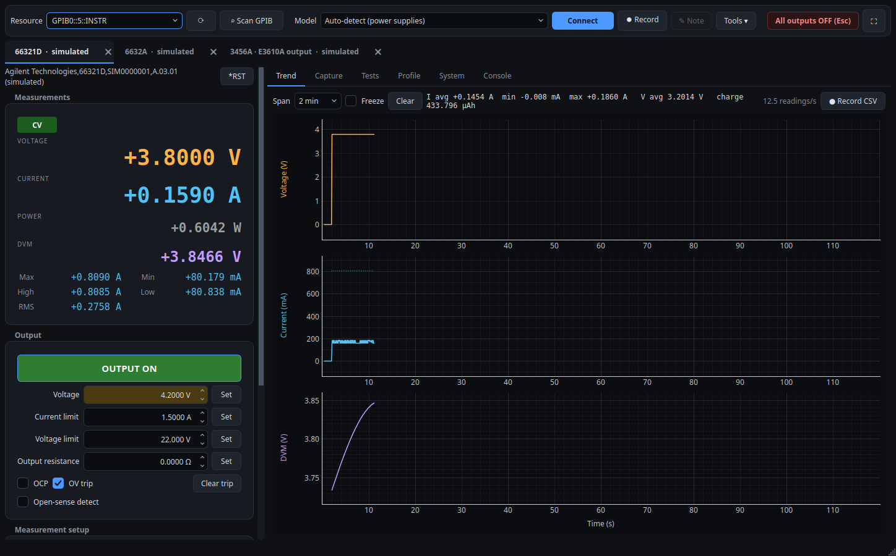
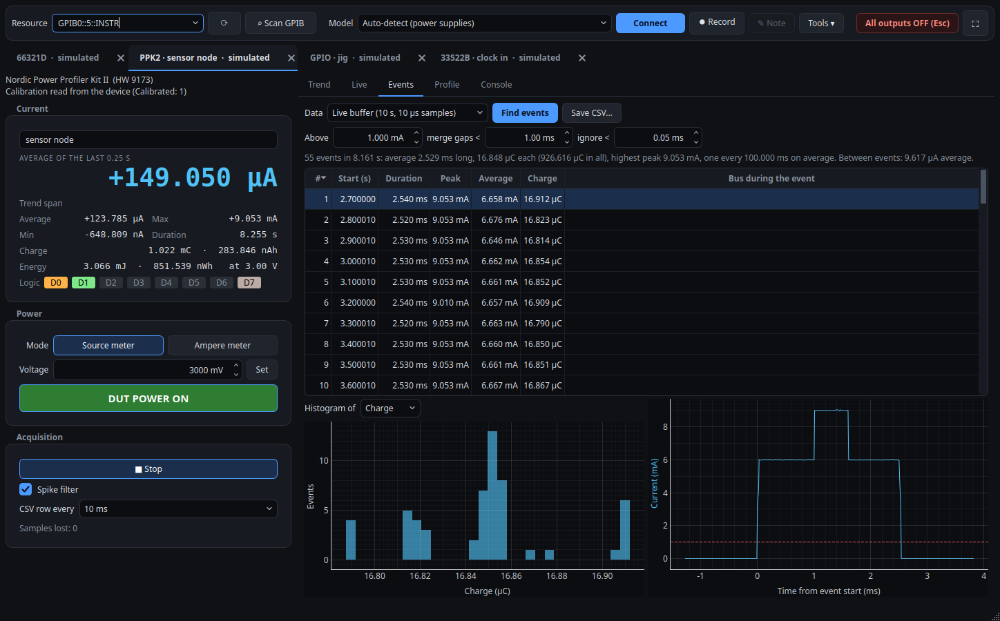
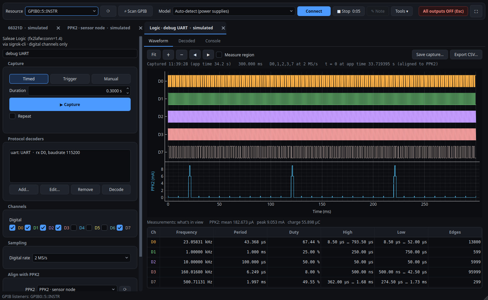
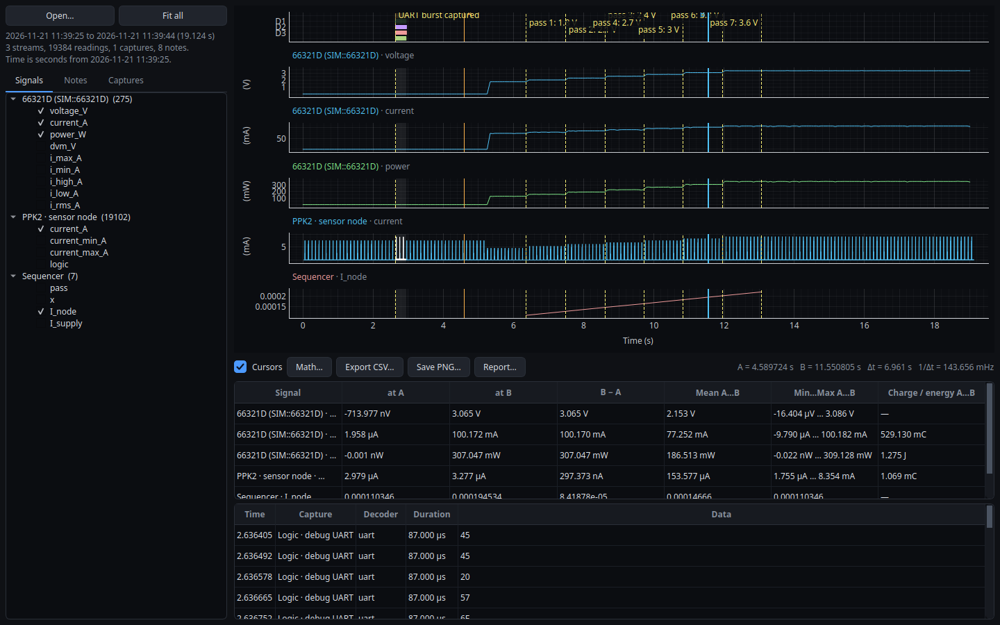
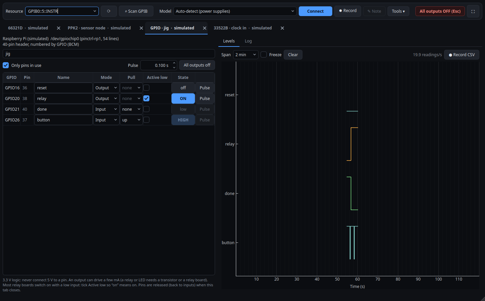
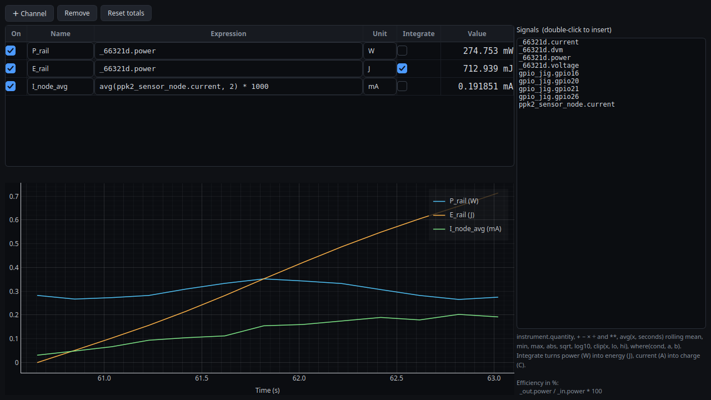

# EE Workbench

A Linux desktop app (PyQt6) for controlling, logging and automating a bench of test instruments: GPIB supplies and meters, a power profiler, logic analyzers, function generators and the Raspberry Pi's GPIO pins. It runs on a PC or full screen on a Pi with a touch screen.

| Instrument | Support |
|---|---|
| Agilent 66321D / 66321B / 66311B DC source | Setpoints, protection, output resistance, DVM, pulse statistics; triggered waveform capture with cursors and automatic measurements; battery-life, battery-emulator, sequencer and I-V tests; rear port, display, saved setups, self-test |
| HP 6632A / 6633A / 6634A DC supply | Setpoints, OVP/OCP, readback, status |
| HP 3456A 6½-digit DMM | Function, range, integration time, autozero, filter, null, statistics |
| Nordic Power Profiler Kit II (USB) | Source or ampere meter at 100 kS/s; DUT power and voltage; live full-rate view with logic inputs D0–D7; trend with region average, charge and energy |
| Saleae Logic 8 / Pro 8 / Pro 16 (via Logic 2) | Timed, triggered and manual captures of digital and analog channels; frequency, duty, pulse-width and voltage measurements over the view or a region; Logic 2's protocol decoders (UART, I²C, SPI, any other) in a searchable table; save as .sal or export CSV |
| sigrok logic analyzers (via sigrok-cli) | The same panel for anything sigrok drives: 24 MHz fx2lafw "Saleae clones", the original Saleae Logic / Logic16, DSLogic, …; sigrok's decoders; save as .sr (opens in PulseView). Runs on the Raspberry Pi |
| Function generators (LAN, USB, GPIB) | Keysight 33500B/33600A/332x0A, Rigol DG800–DG4000, Siglent SDG: waveform, frequency, amplitude, offset, duty, outputs, per channel; frequency and amplitude sweeps |
| Raspberry Pi GPIO header | Name pins, drive relays and resets, pulse a DUT's buttons, read "done" pins, log levels |

Across instruments:

- **Sequencer with limits.** Steps (set, wait, measure, capture, profile, wait for a GPIO pin, note) run once, N times or as a sweep, or a Python script with the same `bench` API. Min/max limits mark each pass PASS or FAIL, optionally stopping at the first failure. Results come as a table, a plot and CSV.
- **Reports.** One HTML or PDF page per sequence run or session: verdict, instruments, plots, results, steps and log.
- **Profiles.** Vary any supply, PPK2 or generator setpoint over time (sine, triangle, square, ramp, steps, log steps, a list, or a CSV), for battery curves, brown-out tests and frequency sweeps.
- **Watchdog.** Rules across instruments: *PPK2 current > 50 mA for 10 ms → all outputs off*, *rail < 2.9 V → generator off*, *e-stop pin low → stop the sequence*.
- **PPK2 event finder.** Every current burst with its duration, peak and charge, histograms, the sleep current between bursts, and the decoded bus traffic during each burst.
- **Math channels.** Live expressions such as `_66321d_out.power / _6632a_in.power * 100` (efficiency) or integrated energy, plotted and recorded. They work in the session viewer too.
- **PPK2 ↔ logic-analyzer alignment.** Wire one DUT pin to an analyzer channel and a PPK2 logic input. Each capture is then lined up with the PPK2 to within ±5–10 µs, with the current drawn under the decoded traffic.
- **Sessions.** One file (`.eewb`, SQLite) records every instrument, capture, math channel, result and note. The viewer lays them out on one time axis, with cursors (Δt, mean, charge, energy), math, CSV/PNG export and reports.
- **Setups.** Save the whole bench (instruments, sequence, watchdog, math) under a name, and recall it in one click.
- **Remote API.** Drive the open bench from Jupyter, pytest or CI: `bench = connect(); bench.measure("PPK2", "current", 2.0)`.

Each instrument opens in its own tab with live readouts, trend plots on a shared time base, and CSV recording. **Esc turns every output off**: supplies, PPK2 DUT power, generator channels and GPIO outputs. It also stops a running sequence or profile. Simulators (`SIM::66321D`, `SIM::6632A`, `SIM::3456A`, `SIM::PPK2`, `SIM::SALEAE`, `SIM::SIGROK`, `SIM::FGEN`, `SIM::SDG`, `SIM::GPIO`) let you try everything without hardware.



| | |
|---|---|
|  |  |
| [Sequencer](docs/03-users-guide.md#sequencer) with limits | [PPK2 events](docs/03-users-guide.md#ppk2-events-tab) |
|  |  |
| [Logic + PPK2 alignment](docs/03-users-guide.md#lining-a-capture-up-with-a-ppk2) | [Session viewer](docs/03-users-guide.md#looking-through-a-session) |
|  |  |
| [Pi GPIO](docs/03-users-guide.md#gpio-panel-raspberry-pi-header) | [Math channels](docs/03-users-guide.md#math-channels) |

## Quick start

```bash
./scripts/setup-ubuntu.sh                  # once, on a fresh Ubuntu: apt packages, .venv, sigrok,
                                           # GPIB driver, menu entry (--help for options)
./run.sh GPIB0::5::INSTR 3456A@GPIB0::22::INSTR
./run.sh PPK2@/dev/ttyACM0                 # Nordic PPK2 (also listed as PPK2::… when plugged in)
./run.sh SALEAE@                           # Saleae, through a running Logic 2 (automation server on)
./run.sh SIGROK@fx2lafw                    # a sigrok-supported analyzer (also listed as SIGROK::…)
./run.sh FGEN@TCPIP::192.168.1.50::INSTR   # a LAN function generator
./run.sh GPIO@                             # the Raspberry Pi's GPIO header
./run.sh SIM::66321D SIM::PPK2 SIM::GPIO   # no hardware needed
```

On a Raspberry Pi with a touch screen, `./scripts/setup-pi.sh` installs everything and sets the app to start full screen at login. `ee-workbench.desktop` is a ready-made launcher. See [Raspberry Pi & Touch Screen](docs/05-raspberry-pi.md).

From Python (with **Tools ▾ → Remote API** on):

```python
from ee_workbench.client import connect
bench = connect()
bench.set("66321D", "voltage", 3.3); bench.set("66321D", "output", "on")
print(bench.measure("PPK2", "current", 2.0))
```

## Documentation

Read the guides here on GitHub (the Markdown sources in [`docs/`](docs/)), or as PDFs in [`docs/pdf/`](docs/pdf/). The whole manual is in one file, [EE-Workbench-Manual.pdf](docs/pdf/EE-Workbench-Manual.pdf). Rebuild the PDFs with `scripts/build-docs.sh`.

1. [Hardware & Resources](docs/01-hardware-and-resources.md): supported instruments, function generators, the Pi's GPIO header and its wiring, GPIB addresses, cabling, manuals
2. [Installation & Setup](docs/02-installation.md): setup scripts and their options, GPIB driver, PPK2, Saleae, sigrok, function generators (LAN/USB), GPIO, PDF reports, Remote API, troubleshooting
3. [User's Guide](docs/03-users-guide.md): every panel and control, profiles, events, sequencer and limits, watchdog, math, reports, setups, Remote API, sessions, workflows, file formats
4. [Technical Reference](docs/04-technical-reference.md): command sets, timings, architecture, file formats, the Remote API protocol, adding instruments
5. [Raspberry Pi & Touch Screen](docs/05-raspberry-pi.md): one-step Pi setup, full-screen launcher, touch layout, GPIO, remote use
6. [How-to Guides](docs/06-howtos.md): step-by-step recipes, from sleep current and battery life, to relay power-cycling, pass/fail reports, frequency response, Jupyter and CI

## Tests

```bash
.venv/bin/python -m pytest tests          # runs everything against the simulators; no hardware needed
```
