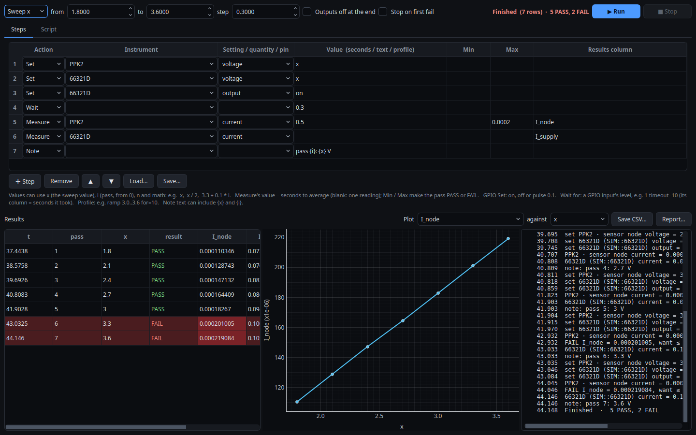
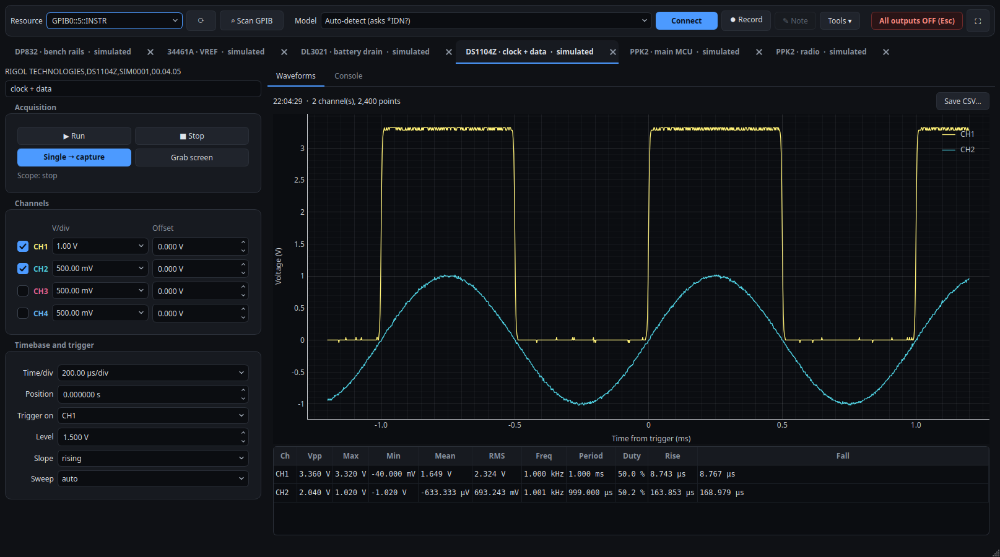
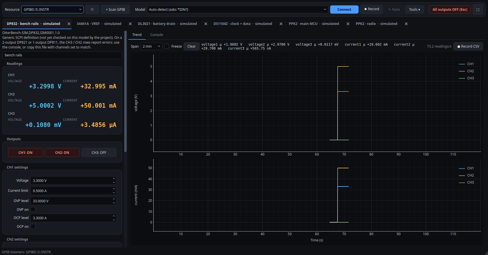
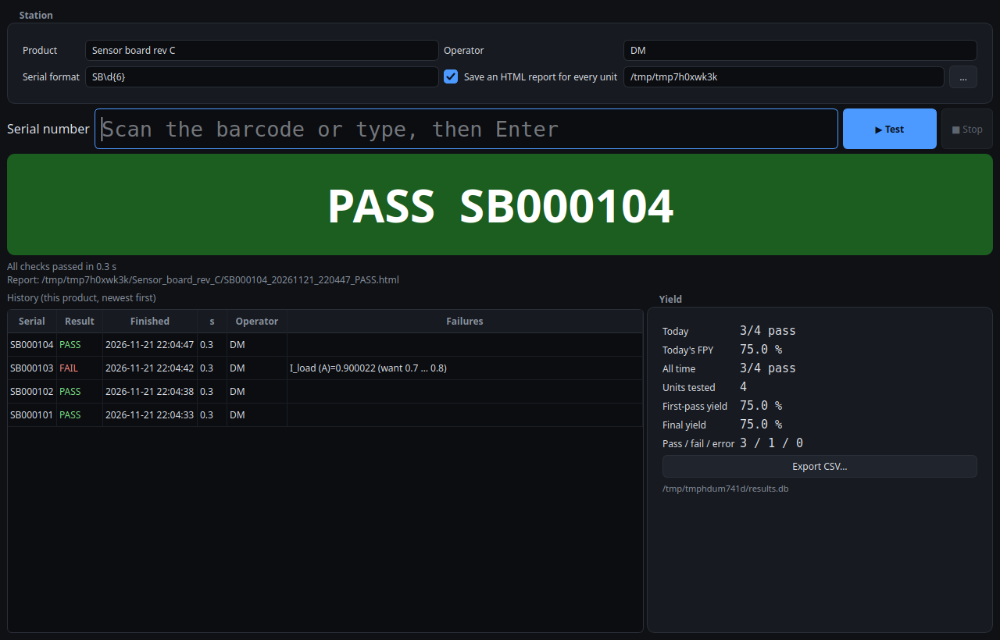
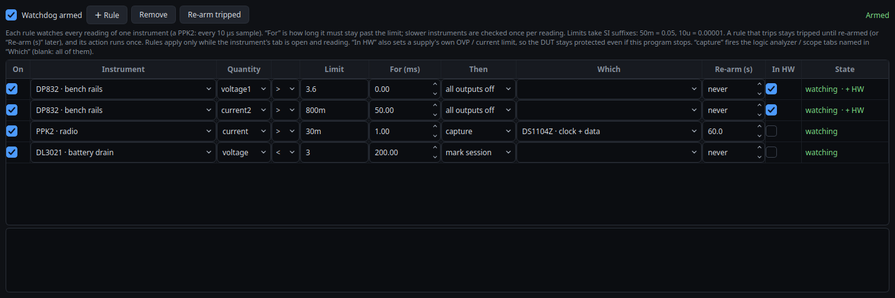

# OtterBench

A Linux desktop app (PyQt6) for controlling, logging and automating a bench of test instruments: GPIB and SCPI supplies, meters and electronic loads, oscilloscopes, a power profiler, logic analyzers, function generators and the Raspberry Pi's GPIO pins. It runs on a PC or full screen on a Pi with a touch screen, as a lab bench, an unattended soak-test rig, or a production test station.

| Instrument | Support |
|---|---|
| Agilent 66309B / 66309D dual DC source | As the 66311B below, plus output 2 (only its readings tried on hardware) |
| Agilent 66321D / 66321B / 66311B DC source | Setpoints, protection, output resistance, DVM, pulse statistics; triggered waveform capture with cursors and automatic measurements; battery-life, battery-emulator, sequencer and I-V tests; rear port, display, saved setups, self-test |
| HP 6632A / 6633A / 6634A DC supply | Setpoints, OVP/OCP, readback, status |
| B&K Precision 393 / 393B handheld DMMs | Read-only over USB: reading, function, HOLD/MAX/REL, second display, statistics, CSV |
| OWON XDM1041 / XDM1241 / XDM2041 bench DMMs | Function, range, rate, second display; follows the front panel; statistics, CSV |
| HP 3456A 6½-digit DMM | Function, range, integration time, autozero, filter, null, statistics |
| Nordic Power Profiler Kit II (USB) | Source or ampere meter at 100 kS/s; DUT power and voltage; live full-rate view with logic inputs D0–D7; trend with region average, charge and energy |
| Saleae Logic 8 / Pro 8 / Pro 16 (via Logic 2) | Timed, triggered and manual captures of digital and analog channels; frequency, duty, pulse-width and voltage measurements over the view or a region; Logic 2's protocol decoders (UART, I²C, SPI, any other) in a searchable table; save as .sal or export CSV |
| sigrok logic analyzers (via sigrok-cli) | The same panel for anything sigrok drives: 24 MHz fx2lafw "Saleae clones", the original Saleae Logic / Logic16, DSLogic, …; sigrok's decoders; save as .sr (opens in PulseView). Runs on the Raspberry Pi |
| Function generators (LAN, USB, GPIB) | Keysight 33500B/33600A/332x0A, Rigol DG800–DG4000, Siglent SDG: waveform, frequency, amplitude, offset, duty, outputs, per channel; frequency and amplitude sweeps |
| Raspberry Pi GPIO header | Name pins, drive relays and resets, pulse a DUT's buttons, read "done" pins, log levels |
| Bench multimeters (SCPI) | Keysight 34401A/344xxA, Keithley 2000-series and DMM6500/7510, Rigol DM3058/3068, Siglent SDM3000X, any SCPI meter: function, NPLC, readings with their unit |
| Electronic loads (SCPI) | Rigol DL3021/3031, Siglent SDL1020X/1030X, Keithley 2380 / B&K 8600: CC/CV/CR/CP mode and levels, input, V/I/P readings |
| Kiprim DC310Pro / DC605Pro, OWON SPM3103 / SPM6053 | Supply with a built-in multimeter: both at once, over USB |
| Riden RD60xx / RK6006, Korad KA3005P / Tenma 72-2540, Atorch PX-100 / DL24 | Cheap USB supplies and loads, over their own protocols: setpoints, protection, output, readings |
| Thermometers | Center 309 / Voltcraft K204 loggers (USB); on a Pi: DS18B20, MAX31855 and MAX31865 boards. For the watchdog, the sequencer and battery tests |
| LCR meters | East Tester ET44/ET45, Keysight E4980A/AL: both parameters, frequency, level, model |
| DUT serial console (UART) | Firmware output on the same time axis as current and voltage; numbers picked out of the text; the sequencer sends commands and judges the answers |
| Programmable supplies (SCPI) | Rigol DP832/831/821, Keysight E36311A–13A, Siglent SPD3303X, any single-output SCPI supply: per-output setpoints, OVP/OCP, outputs |
| Oscilloscopes | Rigol DS1000Z/DS2000A/MSO5000/DHO, Keysight InfiniiVision 1000X–6000X, Tektronix TBS/MDO3/MSO2–6/DPO, Siglent SDS1000X-E/2000X-E: channels, timebase, trigger, run/stop/single, waveforms with Vpp/freq/duty/rise… |
| **Anything else that speaks SCPI** | Describe it in a [small TOML file](docs/06-howtos.md#add-your-own-scpi-instrument): its tab, simulator, sequencer and watchdog support come with it, no code needed |

The [compatibility list](docs/01-hardware-and-resources.md#compatibility) says which models have been checked on real hardware and which so far only against simulators written from the makers' manuals. Several units of any instrument can be open at once (two PPK2s, three supplies), each in its own named tab.

Across instruments:

- **Sequencer with limits.** Steps (set, wait, measure, capture, profile, wait for a GPIO pin, run a program such as a flasher, note) run once, N times or as a sweep, with nested loops, retries and conditions, or a Python script with the same `bench` API. Min/max limits mark each pass PASS or FAIL, optionally stopping at the first failure. Results come as a table, a plot and CSV.
- **Reports.** One HTML or PDF page per sequence run or session: verdict, instruments, plots, results, steps and log.
- **Profiles.** Vary any supply, PPK2 or generator setpoint over time (sine, triangle, square, ramp, steps, log steps, a list, or a CSV), for battery curves, brown-out tests and frequency sweeps.
- **Watchdog.** Rules across instruments: *PPK2 current > 50 mA for 10 ms → all outputs off*, *rail < 2.9 V → generator off*, *e-stop pin low → stop the sequence*, *current spike → capture on the scope*. **In HW** also sets a supply's own OVP / current limit from the rule, so the DUT stays protected even if the computer stops.
- **PPK2 event finder.** Every current burst with its duration, peak and charge, histograms, the sleep current between bursts, and the decoded bus traffic during each burst.
- **Math channels.** Live expressions such as `_66321d_out.power / _6632a_in.power * 100` (efficiency) or integrated energy, plotted and recorded. They work in the session viewer too.
- **Bode plots.** Gain and phase with any supported generator and scope: −3 dB points, phase and gain margins, reference sweep.
- **Regulator test.** Input voltage × load sweeps with a supply and a load: efficiency, losses, line and load regulation, pass / fail, report.
- **Load transient test.** Steps a load and measures droop, overshoot and recovery on a scope.
- **Battery tester.** Charge / rest / discharge cycles with a load (or a 66321D sinking): capacity, energy and internal resistance per cycle.
- **Calibration log.** Due dates per instrument, checks of one meter against a better one, and the status in every report.
- **Measurement uncertainty.** Enter an instrument's accuracy and every reading shows its ±; readings within it of a limit can be marked or failed.
- **Hardware check.** Goes through an instrument's driver step by step, and keeps the traffic as a tape the test suite replays.
- **Scope extras.** The scope's own screenshot in sessions and reports, mask tests, and waveforms replayed on a function generator.
- **Identify port.** Finds out what is on a USB serial port by asking only read-only questions.
- **PPK2 ↔ logic-analyzer alignment.** Wire one DUT pin to an analyzer channel and a PPK2 logic input. Each capture is then lined up with the PPK2 to within ±5–10 µs, with the current drawn under the decoded traffic.
- **Sessions.** One file (`.otter`, SQLite) records every instrument, capture, math channel, result and note. The viewer lays them out on one time axis, with cursors (Δt, mean, charge, energy), math, CSV/PNG export and reports. A **flight-recorder** mode keeps only the seconds before and after each event (a watchdog trip, a capture, a note), for overnight runs.
- **Compare sessions.** Two recordings overlaid, with differences and limits; also a command for CI.
- **Production test.** Scan a serial number, the sequence runs, a big PASS / FAIL banner says where the unit goes. Every unit goes into a results database with history, first-pass and final yield, per-unit HTML reports and CSV export.
- **Unattended runs.** Outputs off on quit or after a crash, automatic reconnect when a USB cable is replugged or an instrument power-cycled, resuming a sequence after a crash, and a heartbeat GPIO pin for an external hardware watchdog.
- **Several PPK2s in step.** Line up two or more PPK2s' time axes through a shared logic input, to within tens of µs.
- **Setups.** Save the whole bench (instruments, sequence, watchdog, math, wiring notes with a photo) under a name, and recall it in one click.
- **Remote API.** Drive the open bench from Jupyter, pytest or CI: `bench = connect(); bench.measure("PPK2", "current", 2.0)`.

Each instrument opens in its own tab with live readouts, trend plots on a shared time base, and CSV recording. **Esc turns every output off**: supplies, PPK2 DUT power, generator channels and GPIO outputs. It also stops a running sequence or profile.

**Built to keep running.** An error inside the app is logged to `~/.config/otterbench/crash.log` and reported once, never closing the window or touching the outputs. An instrument that stops answering gets a **⟳ Reconnect** button on its tab. Damaged settings files cost only the damaged entries, and Esc still reaches every other instrument if one fails. `./run.sh --restart-on-crash` brings an unattended screen back after a hard crash (the Pi's autostart uses it). See [When something goes wrong](docs/03-users-guide.md#when-something-goes-wrong). Every instrument has a simulator (`SIM::66321D`, `SIM::PPK2`, `SIM::34461A`, `SIM::DP832`, `SIM::DL3021`, `SIM::SCOPE`, … see [Simulators](docs/03-users-guide.md#simulators)), so everything can be tried without hardware.


| | |
|---|---|
|  |  |
| [Sequencer](docs/03-users-guide.md#sequencer) with limits | [PPK2 events](docs/03-users-guide.md#ppk2-events-tab) |
|  |  |
| [Logic + PPK2 alignment](docs/03-users-guide.md#lining-a-capture-up-with-a-ppk2) | [Session viewer](docs/03-users-guide.md#looking-through-a-session) |
|  |  |
| [Pi GPIO](docs/03-users-guide.md#gpio-panel-raspberry-pi-header) | [Math channels](docs/03-users-guide.md#math-channels) |
|  |  |
| [Oscilloscope](docs/03-users-guide.md#oscilloscope-panel) | [SCPI supplies, meters, loads](docs/03-users-guide.md#meter-load-and-supply-panel-scpi) |
|  |  |
| [Production test](docs/03-users-guide.md#production-test) | [Watchdog](docs/03-users-guide.md#watchdog) with limits in the supply |

## Quick start

Build a `.deb` (`scripts/build-deb.sh`) or an AppImage (`scripts/build-appimage.sh`) for a one-step install ([Packages](docs/02-installation.md#packages)), or run from the source folder:

```bash
./scripts/setup-ubuntu.sh                  # once, on a fresh Ubuntu: apt packages, .venv, sigrok,
                                           # GPIB driver, menu entry (--help for options)
./run.sh GPIB0::5::INSTR 3456A@GPIB0::22::INSTR
./run.sh PPK2@/dev/ttyACM0                 # Nordic PPK2 (also listed as PPK2::… when plugged in)
./run.sh SALEAE@                           # Saleae, through a running Logic 2 (automation server on)
./run.sh SIGROK@fx2lafw                    # a sigrok-supported analyzer (also listed as SIGROK::…)
./run.sh FGEN@TCPIP::192.168.1.50::INSTR   # a LAN function generator
./run.sh GPIO@                             # the Raspberry Pi's GPIO header
./run.sh TCPIP::192.168.1.60::INSTR        # a LAN meter / load / supply / scope (auto-detected)
./run.sh SCPI:DL3021@USB0::0x1AB1::0x0E11::DL3A000000001::INSTR   # ... or named
./run.sh SIM::66321D SIM::PPK2 SIM::GPIO   # no hardware needed
./run.sh SIM::DP832 SIM::DL3021 SIM::SCOPE SIM::PPK2 SIM::PPK2#2
./run.sh --restart-on-crash --fullscreen   # kiosk: start again if it ever crashes
```

On a Raspberry Pi with a touch screen, `./scripts/setup-pi.sh` installs everything and sets the app to start full screen at login. `otterbench.desktop` is a ready-made launcher. See [Raspberry Pi & Touch Screen](docs/05-raspberry-pi.md).

From Python (with **Tools ▾ → Remote API** on):

```python
from otterbench.client import connect
bench = connect()
bench.set("66321D", "voltage", 3.3); bench.set("66321D", "output", "on")
print(bench.measure("PPK2", "current", 2.0))
```

## Documentation

Read the guides here on GitHub (the Markdown sources in [`docs/`](docs/)), or as PDFs in [`docs/pdf/`](docs/pdf/). The whole manual is in one file, [OtterBench-Manual.pdf](docs/pdf/OtterBench-Manual.pdf). Rebuild the PDFs with `scripts/build-docs.sh`.

1. [Hardware & Resources](docs/01-hardware-and-resources.md): the compatibility list, supported instruments, scopes, meters, loads, the Pi's GPIO header and its wiring, GPIB addresses, cabling, manuals
2. [Installation & Setup](docs/02-installation.md): setup scripts and their options, GPIB driver, PPK2, Saleae, sigrok, LAN/USB instruments (generators, meters, loads, scopes), GPIO, PDF reports, Remote API, troubleshooting
3. [User's Guide](docs/03-users-guide.md): every panel and control, several units and PPK2 alignment, profiles, events, sequencer and limits, watchdog and hardware limits, math, production test, safety and unattended runs, reports, setups, Remote API, sessions and the flight recorder, workflows, file formats, what happens when something goes wrong
4. [Technical Reference](docs/04-technical-reference.md): the instrument definition format, command sets and scope dialects, timings, architecture, error handling and recovery, file formats (sessions, results database, bench state), environment variables, the Remote API protocol, adding instruments
5. [Raspberry Pi & Touch Screen](docs/05-raspberry-pi.md): one-step Pi setup, full-screen launcher, touch layout, GPIO, an unattended bench with a heartbeat, a production station, remote use
6. [How-to Guides](docs/06-howtos.md): step-by-step recipes, from sleep current and battery life, to relay power-cycling, pass/fail reports, frequency response, Jupyter and CI, adding your own instrument, a production station, two PPK2s, a battery drain, catching a glitch on the scope, an overnight run, and recovering from a pulled cable or a crash

## Tests

```bash
.venv/bin/python -m pytest tests          # runs everything against the simulators; no hardware needed
.venv/bin/python -m otterbench.check_instruments   # validate every instrument definition file
```

## Reporting what works

Many instruments here have so far been checked only against simulators written from their makers' programming manuals. If you use one on real hardware, whether it works or not, please report it with the instrument's `*IDN?` answer and, for a problem, the tab's **Console** output and `~/.config/otterbench/crash.log`. A definition file that you got working on a new model is the most useful contribution of all.

## Safety

OtterBench switches real power supplies, loads and batteries. It is **not a safety device**: software, cables and computers fail. Its limits, watchdog and battery cut-offs don't replace fuses, a battery's own protection circuit, or someone nearby. Many instruments, and the Bode, regulator and battery tests, have been checked only against simulators. Try them first with something that can't be hurt.

## License

Copyright © 2026 Daniel McCall.

OtterBench is free software: you can redistribute it and/or modify it under the terms of the [GNU General Public License, version 3](LICENSE) (GPL-3.0-only). It comes with **no warranty**, to the extent the law allows, and the license limits the authors' liability: see its sections 15 to 17. Using it at work is fine. If you distribute it, changed or not, sold or not, the people you give it to must get the source code under the same license.

The license covers the code, not the OtterBench name and logo as marks of origin: a changed version that you distribute should use another name and logo.

Other people's software that it uses keeps its own license: see the [Technical Reference](docs/04-technical-reference.md#licences-and-third-party-code). To contribute, see [CONTRIBUTING.md](CONTRIBUTING.md).
