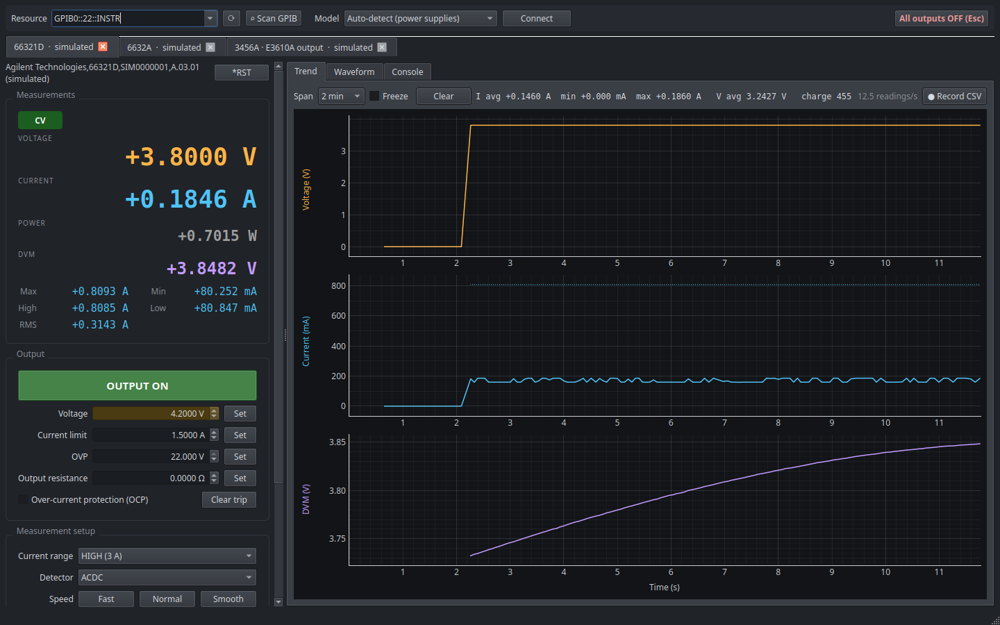
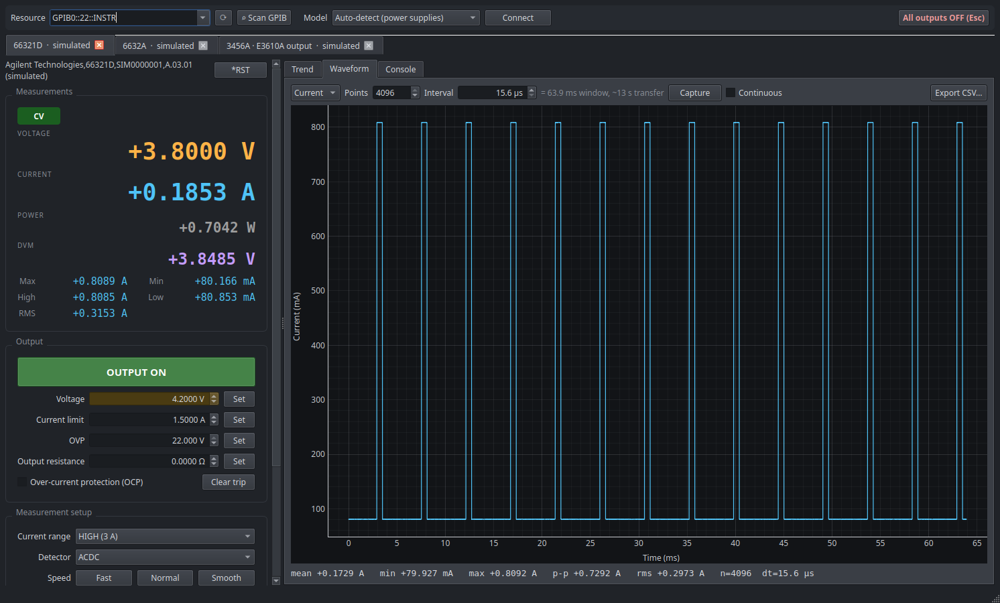
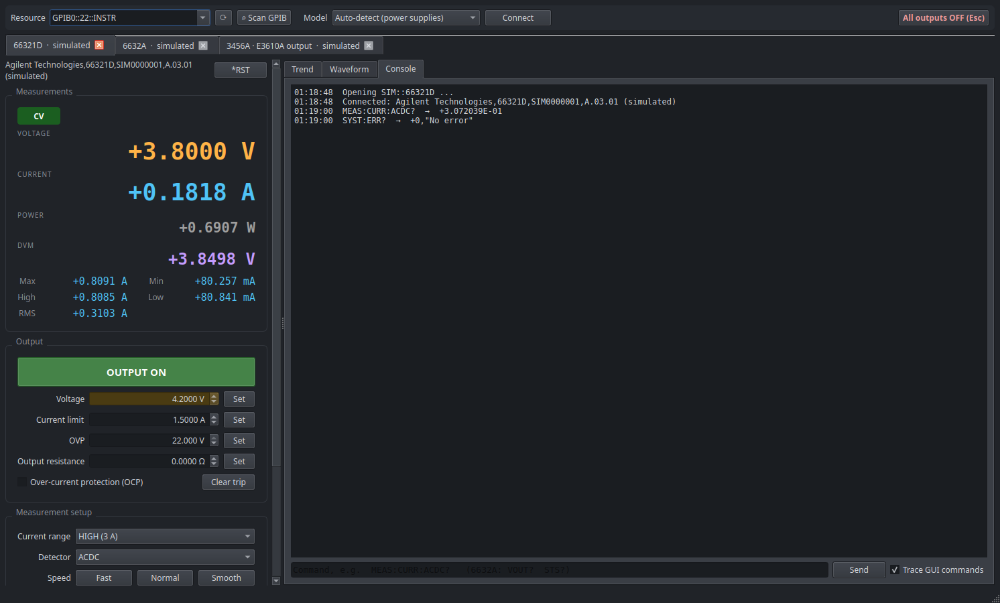
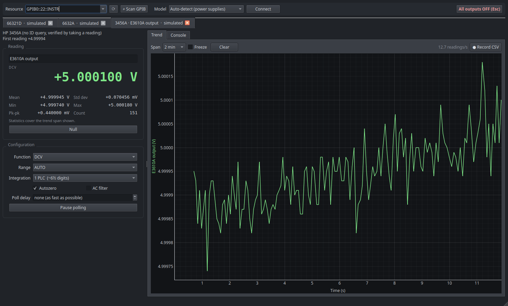

# User's Guide

## Starting up

Run `./run.sh` from the project folder. With no arguments the window opens empty, ready for you to connect.

The **toolbar** along the top is always visible:

| Control | What it does |
|---|---|
| **Resource** | The VISA address, e.g. `GPIB0::5::INSTR`. You can type in the box. |
| **⟳** | Re-list the VISA resources. |
| **⌕ Scan GPIB** | Find every address with an instrument listening. It sends no commands, so it's safe for the 3456A. |
| **Model** | *Auto-detect* identifies the supplies. **Choose HP 3456A by hand.** |
| **Baud** | Appears only for serial (`ASRL…`) resources. |
| **Connect** | Opens the instrument in a new tab. |
| **All outputs OFF (Esc)** | Turns off the output of every connected supply. |

Each instrument gets its own **tab**. Closing a tab disconnects that instrument but leaves its outputs as they are. All tabs share one time axis (seconds since the app started), so you can line up events across instruments.

> **Safety:** **Esc** works from anywhere in the window. It turns *off* the output of every supply and never turns one on. Connecting to an instrument never changes its output; the app reads the current settings first.

## Power-supply panel: Agilent 66321D

### Measurements

- **Mode badge:** **CV** (green, constant voltage), **CC** (red, current limit), **CC-** (sinking current), **OFF**.
- **Flags** (in red) come from the instrument's status register:

| Flag | Meaning | What to do |
|---|---|---|
| OV | Over-voltage protection tripped | Lower the voltage or raise OVP, then **Clear trip** |
| OCP | Over-current protection tripped | Remove the overload or raise the limit, then **Clear trip** |
| OT | Over-temperature | Let it cool; check the airflow |
| RI / INH | Remote inhibit input active | Check the rear INH input |
| UNREG | Output can't regulate | Check the load, sense leads and AC line |
| OVLD | Measurement overload | Use a higher current range |

- **Voltage / Current / Power** readouts. Current switches automatically between mA and A.
- **DVM** shows the rear-panel DVM input when **Read DVM input** is ticked (D models only).
- **Pulse statistics** (when ticked): **Max/Min** are the extremes within one acquisition. **High/Low** are the two levels of a pulsed waveform (for example, transmit burst versus idle). **RMS** is the true RMS current.

### Output

- **OUTPUT ON/OFF** toggles the output. It turns green while the output is on.
- **Voltage, Current limit, OVP, Output resistance:** type a value and press **Enter** or **Set**. A box turns **amber** when its value differs from what the instrument has, meaning "not applied yet". Turning the mouse wheel over a box does nothing unless you've clicked into it first, so scrolling the panel can't change a live setpoint.
- **Output resistance** (−40 mΩ to 1 Ω) makes the supply behave like a battery with internal resistance. Use it to test how a device handles supply droop.
- **Over-current protection (OCP):** when ticked, the supply turns its output *off* instead of limiting the current.
- **Clear trip** resets a latched OV or OCP trip. Remove the cause first.
- **\*RST** returns the supply to its power-on defaults (output off). The app asks you to confirm first.

### Measurement setup and speed

The 66321D digitizes the output and averages each reading over *samples × interval*. Fewer samples give faster updates, more samples give smoother readings. Times measured on the real 66321D over GPIB:

| Preset | Window | V + I + status | Current only |
|---|---|---|---|
| **Fast** (256 samples) | 4 ms | ~21 readings/s *(measured)* | ~32 readings/s *(measured)* |
| **Normal** (1024 samples) | 16 ms | ~13 readings/s | ~20 readings/s |
| **Smooth** (2048 samples, the default) | 32 ms | ~9 readings/s *(measured)* | ~15 readings/s |

- **Measure voltage:** untick it for faster current-only logging. The supply measures voltage and current one after the other, so voltage costs a second acquisition.
- **Pulse statistics** add no extra acquisition. **Read DVM input** adds one.
- **Current range:** **HIGH (3 A)**, **LOW (20 mA)** for sleep and standby currents, or **AUTO**.
- **Detector:** **ACDC** measures the whole waveform (use it for pulsed loads); **DC** gives the DC component only.
- **Poll delay:** extra time between readings. Leave it at *none* for maximum speed, or raise it for long logs.

> **Pulsed loads with short windows:** with a bursty load (e.g. 577 µs bursts every 4.6 ms), a 4 ms window catches a different part of each burst every time, so the trend jumps around. Use **Smooth** for a stable average, or the **Waveform** tab to see the bursts themselves.

### Trend tab

Strip charts of voltage, current (with the per-reading **max** as a dotted line when pulse statistics are on) and the DVM.

- **Span:** 30 s, 2 min, 10 min, 1 h, or All. **Freeze** pauses the display (data keeps arriving). **Clear** empties the plots.
- The stats line above the plot shows average, minimum and maximum current, average voltage, and the **charge** delivered (mAh/Ah) over the span. Use it for battery-life estimates.
- Drag a plot to pan, use the mouse wheel to zoom, and right-click for export and autoscale options.
- **● Record CSV** writes every reading to a file until you press it again.

### Waveform tab

This captures up to 4096 points at intervals down to 15.6 µs (a 64 ms window). Use it to look at transmit bursts, inrush current or load steps.

- Choose **Current** or **Voltage**, the number of **Points** and the **Interval**. The label shows the time window and the expected transfer time.
- **Capture** takes one shot; **Continuous** repeats it. **Export CSV…** saves `t_s` and the value for each point.
- The statistics line shows mean, min, max, peak-to-peak and RMS.
- **It's slow by design:** the 66321D sends array data at about 4 KB/s, so 1024 points take about 3 s and 4096 take about 13 s. Normal polling pauses during a capture.

### Console tab

Type any command (SCPI for the 66321D, e.g. `MEAS:CURR:ACDC?`) and press **Enter**. Queries (ending in `?`) show the reply. **Trace GUI commands** logs every command the app sends, which is handy for learning the command set or writing your own scripts. Instrument errors appear here too, prefixed with ⚠.

## Power-supply panel: HP 6632A

It works the same way as the 66321D panel, with these differences:

- **Setpoints can't be read back.** The 6632A has no way to report its programmed voltage or current. The boxes start amber ("unknown") and the output shows **OUTPUT ?** until you set them. After that they show what this app sent. Changes made on the front panel aren't seen.
- To keep a stray **Set** from causing harm, the OVP box starts at its maximum (22 V). Programming OVP below the output voltage fires the 6632A's crowbar, which shorts the output.
- **Clear trip** sends `RST` (resets a latched OV or OC). The reset button sends **CLR**, which returns the supply to its power-on defaults. **This turns the output ON at 0 V**, and the confirmation dialog says so.
- It has no measurement setup, waveform capture, DVM or output resistance. **Measure voltage** can still be unticked to speed up current logging.
- The minimum current limit is 20 mA. Lower values are raised to 20 mA, as the supply itself does.

## Multimeter panel: HP 3456A

- **Channel name:** label the reading (e.g. "E3610A output"). The name appears on the tab, the plot axis and in the CSV.
- **Function:** DCV, ACV, ACV+DCV, 2W Ω, 4W Ω, offset-compensated (OC) 2W/4W Ω, or DCV/DCV ratio.
- **Range:** AUTO or a fixed range. Fixed ranges are faster and avoid range-switching glitches in logs.
- **Integration** (power-line cycles, PLC). Rates are *estimates* for 60 Hz mains. The **readings/s** counter shows the real rate.

| Setting | Use for | Approximate rate (autozero on) |
|---|---|---|
| 0.01 PLC | fast changes, 4½ digits | ~25/s (limited by the bus) |
| 0.1 PLC | general logging | ~20/s |
| 1 PLC | 6½ digits, rejects mains hum | ~12/s |
| 10 PLC | low-noise measurements | ~3/s |
| 100 PLC | lowest noise | one reading every ~3.4 s |

- **Autozero** re-measures the zero offset on every reading, which halves the speed. Turn it off for speed on short runs.
- **AC filter** smooths noisy DC signals but adds settling time.
- **Null** stores the next reading and subtracts it from all later ones. Short the leads, press **Null**, then measure. Changing function or null state clears the trend, because mixing units or offsets in one trace would be meaningless.
- **Statistics** (mean, standard deviation, min, max, peak-to-peak, count) cover the span shown in the trend.
- **OVLD** means the input is beyond the selected range.
- **Console:** send raw 3456A program codes (e.g. `F1 R4 T3`). **Send + read** fetches one reading afterwards.

## Workflows

### Monitoring an E3610A (or any manual supply)

1. Connect the 3456A's HI/LO inputs to the E3610A's output terminals.
2. Open the 3456A: choose model **HP 3456A DMM** and address `GPIB0::22::INSTR`, then **Connect**.
3. Set the channel name to "E3610A output", the function to **DCV**, and integration to **1 PLC**.
4. Press **● Record CSV** to log for as long as you need.

### Battery-life (current-profile) logging with the 66321D

1. Set the voltage to the battery voltage (e.g. 3.8 V), with a current limit above the device's peak current.
2. Optionally set the **output resistance** to match the battery (e.g. 0.1 Ω).
3. Choose **Smooth** speed, the **ACDC** detector, and tick **Pulse statistics**.
4. **Record CSV**, then read the average current and the **charge** total off the trend.

### Characterizing a regulator with two supplies and the DMM

Use the 66321D as the input supply, the 6632A as a second rail, and the 3456A on the output. All three trends share one time axis. Record a CSV from each tab and join them on `t_s`.

## CSV formats

**Supply tabs:** `timestamp, t_s, voltage_V, current_A, power_W, mode, flags, dvm_V, i_max_A, i_min_A, i_high_A, i_low_A, i_rms_A`

**3456A tab:** `timestamp, t_s, channel, function, value, unit, overload`

**Waveform export:** `t_s, current_A` (or `voltage_V`)

`t_s` is seconds on the app's shared clock and lines up across all files. Empty cells mean that quantity wasn't measured.

## Simulators

Open the resources `SIM::66321D`, `SIM::6632A` and `SIM::3456A` to try every feature without hardware. The simulated 66321D drives a phone-like load drawing short current bursts. The 6632A drives a 10 Ω resistor. The 3456A reads a slightly drifting 5 V rail, about 1 kΩ, or 120 mV AC.

## Touch screens

On a touch screen (or any display of 1280×800 or smaller) the app uses a touch layout: larger controls, a numeric keypad for setpoints, two taps to turn an output on, and an **＋ Add instrument** dialog instead of the toolbar. See *Raspberry Pi & Touch Screen* for details.

## Keyboard and mouse reference

| Action | How |
|---|---|
| All outputs off | **Esc** |
| Full screen on/off | **F11** |
| Apply a setpoint | **Enter** in the box, or **Set** |
| Zoom a plot | mouse wheel over the plot |
| Pan a plot | drag |
| Autoscale / export a plot | right-click the plot |
| Close an instrument | **×** on its tab |
