# User's Guide

**Contents:** [Starting up](#starting-up) · [66321D supply](#power-supply-panel-agilent-66321d) · [6632A supply](#power-supply-panel-hp-6632a) · [3456A DMM](#multimeter-panel-hp-3456a) · [PPK2](#power-profiler-panel-nordic-ppk2) · [Logic analyzers](#logic-analyzer-panel-saleae-and-sigrok) · [Function generator](#function-generator-panel) · [GPIO](#gpio-panel-raspberry-pi-header) · [Profiles](#profiles-varying-a-setpoint-over-time) · [PPK2 events](#ppk2-events-tab) · [Sequencer & limits](#sequencer) · [Watchdog](#watchdog) · [Math channels](#math-channels) · [Reports](#reports) · [Setups](#setups-the-whole-bench-by-name) · [Remote API](#remote-api-python-and-jupyter) · [Sessions](#sessions-everything-in-one-file) · [Workflows](#workflows) · [CSV formats](#csv-formats) · [Simulators](#simulators) · [Start-up](#instruments-at-start-up) · [Keys](#keyboard-and-mouse-reference)

Step-by-step recipes for common jobs are in [How-to guides](06-howtos.md).

## Starting up

Run `./run.sh` from the project folder. With no arguments the window opens empty, ready for you to connect.


The **toolbar** along the top is always visible:

| Control | What it does |
|---|---|
| **Resource** | The VISA address, e.g. `GPIB0::5::INSTR`. You can type in the box. |
| **⟳** | Re-list the VISA resources. |
| **⌕ Scan GPIB** | Find every address with an instrument listening. It sends no commands, so it's safe for the 3456A. |
| **Model** | *Auto-detect* identifies the supplies. **Choose HP 3456A by hand.** |
| **Baud** | Appears only for serial (`ASRL…`) resources. |
| **Connect** | Opens the instrument in a new tab. |
| **⏺ Record** / **✎ Note** | Record a [session](#sessions-everything-in-one-file); put a note into it (Ctrl+M). |
| **Tools ▾** | [Sequencer](#sequencer), [Watchdog](#watchdog), [Math channels](#math-channels), [Setups](#setups-the-whole-bench-by-name), open a session in the [viewer](#looking-through-a-session), a [session report](#reports), and the [Remote API](#remote-api-python-and-jupyter) switch. |
| **All outputs OFF (Esc)** | Turns off every output: supplies, PPK2 DUT power, function-generator channels and GPIO outputs. It also stops a running sequence, profile or remote-API call. |

Each instrument gets its own **tab**. Closing a tab disconnects that instrument but leaves its outputs as they are. All tabs share one time axis (seconds since the app started), so you can line up events across instruments.

> **Safety:** **Esc** works from anywhere in the window. It turns *off* every output (supplies, PPK2, generators, GPIO) and never turns one on. Connecting to an instrument never changes its output; the app reads the current settings first.

## Power-supply panel: Agilent 66321D


### Measurements

- **Mode badge:** **CV** (green, constant voltage), **CC** (red, current limit), **CC-** (sinking current), **OFF**.
- **Flags** (in red) come from the instrument's status register:

| Flag | Meaning | What to do |
|---|---|---|
| OV | Over-voltage trip (output went ~2 V above the setting) | Find what back-drove the output, then **Clear trip** |
| OCP | Over-current protection tripped | Remove the overload or raise the limit, then **Clear trip** |
| OT | Over-temperature | Let it cool; check the airflow |
| SENSE-OPEN | A remote-sense lead is disconnected (when open-sense detection is on) | Check the sense leads, then **Clear trip** |
| FP-LOCAL | The front panel has taken local control | Press the supply's Local key again or send any command |
| RI / INH | Remote inhibit input active | Check the rear INH input |
| UNREG | Output can't regulate | Check the load, sense leads and AC line |
| OVLD | Measurement overload | Use a higher current range |

- **Voltage / Current / Power** readouts. Current switches automatically between mA and A.
- **DVM** shows the rear-panel DVM input when **Read DVM input** is ticked (D models only).
- **Pulse statistics** (when ticked): **Max/Min** are the extremes within one acquisition. **High/Low** are the two levels of a pulsed waveform (for example, transmit burst versus idle). **RMS** is the true RMS current.

### Output

- **OUTPUT ON/OFF** toggles the output. It turns green while the output is on.
- **Voltage, Current limit, Voltage limit, Output resistance:** type a value and press **Enter** or **Set**. A box turns **amber** when its value differs from what the instrument has, meaning "not applied yet". Turning the mouse wheel over a box does nothing unless you've clicked into it first, so scrolling the panel can't change a live setpoint.
- **Output resistance** (−40 mΩ to 1 Ω) makes the supply behave like a battery with internal resistance. Use it to test how a device handles supply droop.
- **Voltage limit** (the 66321D's `VOLT:PROT`) is the highest voltage the supply will *accept as a setting*, from 0 to 22 V. Use it to make sure nobody can program more than your device can take. It doesn't trip anything.
- **OCP** (over-current protection): when ticked, the supply turns its output *off* instead of limiting the current. The **OCP delay** on the System tab sets how long current limit has to last first.
- **OV trip** (over-voltage protection): turns the output off if the output rises about 2 V above the voltage setting, e.g. when a charger or another supply drives it. On by default.
- **Open-sense detect** (the 66321D's `SENS:PROT:STAT`): turns the output *off* if a remote-sense lead (+S or −S) comes disconnected, instead of letting the supply regulate wrongly with the lead open. Tick it when the sense leads run to the DUT. With the local-sense jumpers fitted it never trips, so leaving it on costs nothing. A trip shows **SENSE-OPEN** with "a sense lead is open"; reconnect the lead, then **Clear trip**. The same switch is under **System → Protection**. It's off after **\*RST**. To have it on at every power-up, tick it, save the state to location 0 on the System tab, and set the power-on state to *Recall 0*; then power-cycle once and check the box comes back ticked, since what `*SAV` keeps varies with firmware. See [Sensing: local or remote](#sensing-local-or-remote).
- **Clear trip** resets a latched OV, OCP or open-sense trip. Remove the cause first.
- **\*RST** returns the supply to its power-on defaults (output off). The app asks you to confirm first.

### Measurement setup and speed

The 66321D digitizes the output and averages each reading over *samples × interval*. Fewer samples give faster updates, more samples give smoother readings. Times measured on the real 66321D over GPIB:

| Preset | Window | V + I + status | Current only |
|---|---|---|---|
| **Fast** (256 samples) | 4 ms | ~21 readings/s *(measured)* | ~32 readings/s *(measured)* |
| **Normal** (1024 samples) | 16 ms | ~13 readings/s | ~20 readings/s |
| **Smooth** (2048 samples, the default) | 32 ms | ~9 readings/s *(measured)* | ~15 readings/s |

- **Measure voltage:** untick it for faster current-only logging. The supply measures voltage and current one after the other, so voltage costs a second acquisition.
- **Pulse statistics** add no extra acquisition. **Read DVM input** adds one.
- **Current range:** **3 A**, **1 A**, or **20 mA** for sleep and standby currents. Pick the lowest range that still covers the *peak* current: a range that's too low clips the bursts and shows **OVLD**. The 66321D has no auto-ranging.
- **Window:** **Hanning** (the default) reduces the error from ripple when an acquisition isn't a whole number of cycles. **Rectangular** gives the plain average of exactly what was sampled.
- **Detector:** **ACDC** measures the whole waveform (use it for pulsed loads); **DC** gives the DC component only.
- **Poll delay:** extra time between readings. Leave it at *none* for maximum speed, or raise it for long logs.

> **Pulsed loads with short windows:** with a bursty load (e.g. 577 µs bursts every 4.6 ms), a 4 ms window catches a different part of each burst every time, so the trend jumps around. Use **Smooth** for a stable average, or the **Capture** tab to see the bursts themselves.

### Trend tab

Strip charts of voltage, current (with the per-reading **max** as a dotted line when pulse statistics are on) and the DVM.

- **Span:** 10 s, 30 s, 2 min, 10 min, 1 h, or All. **Freeze** pauses the display (data keeps arriving). **Clear** empties the plots.
- The stats line above the plot shows average, minimum and maximum current, average voltage, and the **charge** delivered (mAh/Ah) over the span. Use it for battery-life estimates.
- Drag a plot to pan, use the mouse wheel to zoom, and right-click for export and autoscale options.
- The trend scrolls smoothly with the clock rather than jumping at each reading. The vertical scale grows as soon as a reading would go off-scale but shrinks only gradually, once the data uses less than half of it. Zooming vertically by hand turns this off; the plot's **A** button turns it back on.
- **● Record CSV** writes every reading to a file until you press it again.

### Capture tab


A storage-scope view of the output: up to 4096 points at intervals down to 15.6 µs (a 64 ms window), triggered on the signal itself, with data from *before* the trigger. Use it for transmit bursts, inrush current, wake-ups and load steps.

**Setting up a capture (left side):**

- **Signal:** current or voltage. **Points** and **Interval** set the record; the line under them shows the time covered and how long the transfer takes.
- **Trigger:**

| Trigger | What starts the capture |
|---|---|
| **Immediate** | Pressing **Single** or **Run**. |
| **Signal level** | The signal crossing **Level** on the chosen **Edge** (rising, falling or either). **Hysteresis** is a band around the level the signal must cross completely, so noise doesn't trigger it. **50 %** sets the level halfway between the high and low of the last capture. |
| **External input** | A falling edge on pin 3 of the rear control port. The port must be set to *External trigger*; the tab offers to do it. |
| **Output step** | The supply changes its output to the ticked **Voltage**, **Current limit** and/or **Resistance** values and captures the response at the same instant. **Put the levels back afterwards** restores them when the capture is done. **Step now** changes the levels the same way without capturing. |

- **Pre-trigger:** how much of the record comes before the trigger. 25 % shows what led up to the event; 0 % starts at the trigger.
- **Segments:** capture several triggers in a row (points × segments ≤ 4096). **Overlay** draws them on top of each other, like a scope's persistence.
- **Single** captures once; **Run** repeats until **Stop**. While a level or external trigger waits, the status turns amber. **Stop**, **ALL OFF** and **Esc** abort it.

> Readings on the left pause while a capture is armed: the supply has one digitizer. The 66321D sends array data at about 3.7 KB/s, so 1024 points take about 1.2 s to transfer.

**Reading the result (right side):**

- Time is shown relative to the trigger (dashed line). The red dashed line is the trigger level.
- **Measurements** are worked out automatically from the first segment: mean, RMS, min/max, high/low levels, peak-to-peak, and for pulse trains the period, frequency, pulse width, duty cycle and 10–90 % rise and fall times. For current, the **charge** in the record (in Ah) and the **energy** (Wh, at the present output voltage) are shown too; hover for coulombs and joules. *Supply's own* is the 663xx's own DC and RMS figure for comparison.
- **Cursors** adds two draggable markers. The line under the plot shows each cursor's time and value, Δt, 1/Δt, Δ, and the mean, RMS, min, max, charge and energy *between* them. Use it to measure one burst.
- **View:** **Time**, **Histogram** (share of time spent at each level, useful for sleep/active ratios) or **Spectrum** (FFT with a Hann window, to find ripple and switching frequencies).
- **Reference** keeps the current capture in grey behind the following ones, for before/after comparisons. Press it again to clear it.
- **Save…** writes CSV (`t_s, segment, current_A` or `voltage_V`, with the settings on the last line) or a PNG of the plot. **Open…** loads a saved CSV back for measuring.

### Tests tab

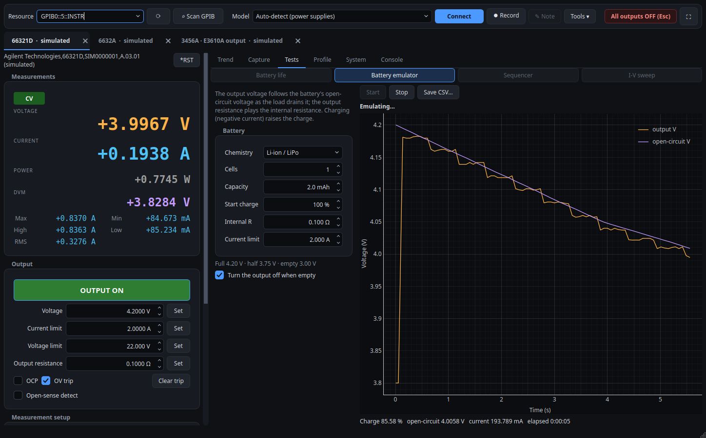

Ready-made procedures. Choose one along the top, set it up on the left, then press **Start**. **Stop**, **ALL OFF** and **Esc** end any test. A test that turns the output on asks you to confirm first. **Save CSV…** writes the test's data.

- **Battery life:** power your device from the supply and log what it uses. It shows elapsed time, average current, **charge** (mAh) and **energy** (mWh), and projects how long a battery of the **Capacity** you enter would last. It stops after the **Duration**, when the **Charge used** limit is reached, or if the voltage falls **below** the cutoff.
- **Battery emulator:** the output behaves like a battery running down. Choose the **Chemistry** (Li-ion/LiPo, LiFePO4, NiMH or alkaline), the number of **Cells** in series, the **Capacity** and the **Start charge**. As the load draws current the charge goes down and the voltage follows that chemistry's discharge curve. The **Internal R** is set as the supply's output resistance, so the voltage also sags under load like a real cell. Negative current (charging) raises the charge. Use a small capacity to run through a whole discharge in minutes. It stops when the battery is empty and puts the output resistance back to 0 Ω.
- **Sequencer:** a table of steps, each with **Volts**, **Amps** (current limit), **Hold s** and **Ramp s**. A non-zero ramp moves smoothly from the previous step's values. **Repeat** runs the whole table several times. **Open…** and **Save…** store sequences as JSON files. The plot shows the set voltage and the measured voltage.
- **I-V sweep:** steps the voltage (with a fixed current limit) or the current limit (with a fixed voltage) through **Points** values from **From** to **To**, waits the **Settle** time at each, and measures. It plots current against voltage and fits a slope (dV/dI). **Sweep back down too** shows hysteresis.

### System tab


The rest of the 66321D's features. Each group appears only on models that have it.

- **Protection:** **Over-voltage trip** (same as **OV trip** under Output), **OCP delay** (0.08 s by default: how long current limit must last before OCP turns the output off; raise it if inrush trips OCP), and **Open sense-lead detection**, which turns the output off if a remote-sense lead comes loose.
- **Software limits:** checked by this app on every reading. They turn the output off if the current stays above, or the voltage stays below, a value for longer than the time you set. They're only as fast as the readings, so use OCP when you need fast protection.
- **Output response:** low or high load capacitance, local or remote sense. **High capacitance, remote sense** suits a phone with its bypass capacitors on long sense leads, but needs more than 5 µF across the output; the app asks before selecting it.
- **Protection events:** trips and warnings the supply reports (over-current, over-voltage, over-temperature, open sense lead, remote inhibit, unregulated, measurement overload), with the time. They also appear in the status bar. The software limits log here too.
- **Rear control port:** choose what pins 1–3 do. With **Remote inhibit / fault**, set the **Remote inhibit** input to latching, live or off, and the **Fault output** and what drives it. With **Digital I/O**, tick **Out 0** and **Out 1** to drive pins 1 and 2, and press **Read** to read the pin 3 input. **External trigger** makes pin 3 the Capture tab's external trigger. The port setting is stored in the supply's non-volatile memory, so the app asks first.
- **Front-panel display:** switch the display off, show a message of up to 14 characters, or press **Normal** to go back to readings.
- **Saved setups:** **Recall 0–3** and **Save 1–3** use the supply's own memories (the app asks first, because a recalled setup can turn the output on). **At power-on** chooses between defaults and saved setup 0. **In this app** keeps named presets of voltage, current limit, voltage limit, OCP and output resistance in `~/.config/ee-workbench/presets.json`; applying one never turns the output on.
- **Instrument:** model, serial number, firmware, options and calibration date. **Self-test** runs the supply's self-test, **Read error queue** shows any errors waiting, and **Reset** sends `*RST`.

### Console tab


Type any command (SCPI for the 66321D, e.g. `MEAS:CURR:ACDC?`) and press **Enter**. Queries (ending in `?`) show the reply. **Trace GUI commands** logs every command the app sends, which is handy for learning the command set or writing your own scripts. Instrument errors appear here too, prefixed with ⚠.

## Power-supply panel: HP 6632A

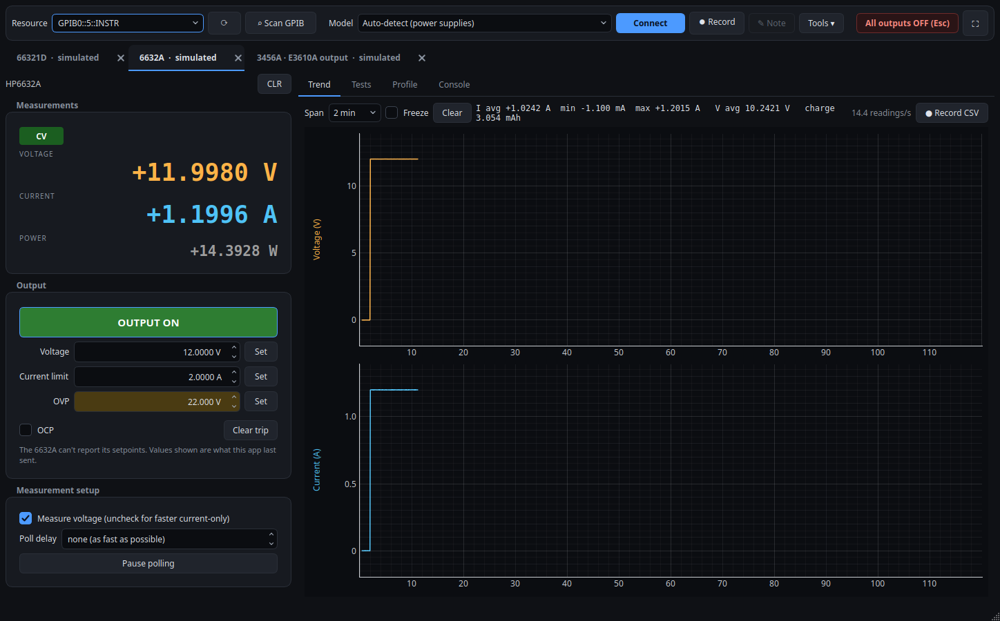

It works the same way as the 66321D panel, with these differences:

- **Setpoints can't be read back.** The 6632A has no way to report its programmed voltage or current. The boxes start amber ("unknown") and the output shows **OUTPUT ?** until you set them. After that they show what this app sent. Changes made on the front panel aren't seen.
- To keep a stray **Set** from causing harm, the OVP box starts at its maximum (22 V). Programming OVP below the output voltage fires the 6632A's crowbar, which shorts the output.
- **Clear trip** sends `RST` (resets a latched OV or OC). The reset button sends **CLR**, which returns the supply to its power-on defaults. **This turns the output ON at 0 V**, and the confirmation dialog says so.
- It has no measurement setup, Capture or System tab, DVM or output resistance. The **Tests** tab works, except for the battery emulator's internal resistance. **Measure voltage** can still be unticked to speed up current logging.
- The minimum current limit is 20 mA. Lower values are raised to 20 mA, as the supply itself does.
- **No open-sense detection.** The 6632A can't tell when a sense lead is open, so there's no checkbox. Its protection against an open sense lead is **OVP**: set it a little above the voltage you're using (e.g. 3.8 V for a 3.3 V rail), and if a sense lead comes loose and the output runs away, the crowbar trips. See [Sensing: local or remote](#sensing-local-or-remote).

### Sensing: local or remote

Neither supply chooses local or remote sensing in software: it always regulates and measures the voltage across its **+S / −S** terminals, and the wiring decides where that is.

| | Local sense | Remote sense |
|---|---|---|
| Wiring | +S jumpered to +OUT and −S to −OUT at the supply (the 66321D's output connector jumpers; the 6632A's barrier-strip straps) | jumpers removed; +S and −S run as a twisted pair to the DUT's terminals |
| What's regulated and measured | the voltage at the supply's terminals | the voltage at the DUT, correcting for the drop in the leads |
| 66321D compensation (System tab) | LLOC or HLOC | LREM or HREM (stable with long sense leads) |
| Open-sense detect (66321D) | harmless; never trips | recommended |

Never leave the sense terminals unconnected (no jumpers, no leads): the output can rise well above the setting. That is what open-sense detection (66321D) and a tight OVP (6632A) protect against. To tell which wiring a supply has without looking, draw a real load current and compare its voltage reading with the 3456A across the DUT: equal means remote sense; lower at the DUT by about the lead drop means local.

## Multimeter panel: HP 3456A


- **Channel name:** label the reading (e.g. "E3610A output"). The name appears on the tab, the plot axis and in the CSV.
- **Function:** DCV, ACV, ACV+DCV, 2W Ω, 4W Ω, offset-compensated (OC) 2W/4W Ω, or DCV/DCV ratio.
- **Range:** AUTO or a fixed range. Fixed ranges are faster and avoid range-switching glitches in logs.
- **Integration** (power-line cycles, PLC). Rates are *estimates* for 60 Hz mains. The **readings/s** counter shows the real rate.

| Setting | Use for | Approximate rate (autozero on) |
|---|---|---|
| 0.01 PLC | fast changes, 4½ digits | ~25/s (limited by the bus) |
| 0.1 PLC | general logging | ~20/s |
| 1 PLC | 6½ digits, rejects mains hum | ~12/s |
| 10 PLC | low-noise measurements | ~3/s |
| 100 PLC | lowest noise | one reading every ~3.4 s |

- **Autozero** re-measures the zero offset on every reading, which halves the speed. Turn it off for speed on short runs.
- **AC filter** smooths noisy DC signals but adds settling time.
- **Null** stores the next reading and subtracts it from all later ones. Short the leads, press **Null**, then measure. Changing function or null state clears the trend, because mixing units or offsets in one trace would be meaningless.
- **Statistics** (mean, standard deviation, min, max, peak-to-peak, count) cover the span shown in the trend.
- **OVLD** means the input is beyond the selected range.
- **Console:** send raw 3456A program codes (e.g. `F1 R4 T3`). **Send + read** fetches one reading afterwards.

## Power profiler panel: Nordic PPK2

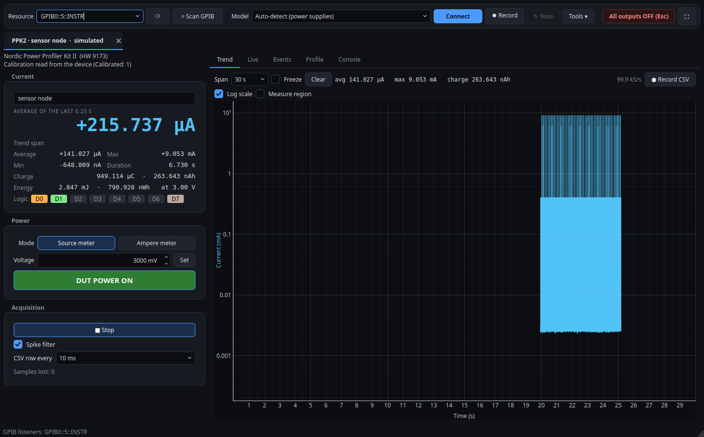

The PPK2 measures current 100,000 times a second. The panel keeps every sample of the last 10 seconds, 1 ms averages for the last ~16 minutes, and 100 ms averages for the whole session.

**Power**

- **Source meter:** the PPK2 powers the DUT from VOUT at the **Voltage** you set (800–5000 mV). Switching to source mode asks first, because VOUT is driven as soon as DUT power is on: disconnect any other supply from the DUT.
- **Ampere meter:** the DUT keeps its own supply and the current runs VIN → VOUT. The voltage box becomes **DUT voltage**. The PPK2 doesn't measure it, but it's used for the calibration's small voltage correction and for the energy figures, so set it to the DUT's supply.
- **DUT POWER** switches the DUT on and off (two taps on a touch screen). It shows **?** after connecting, because the PPK2 can't report it. **Esc** turns it off along with every supply output.

**Readouts**

- The big number is the average of the last 0.25 s.
- **Average, Max, Min, Duration, Charge** (C and Ah) and **Energy** (J and Wh, at the voltage shown) cover the trend span, or the region when **Measure region** is on.
- **Logic** lights show which of D0–D7 were high in the last 0.25 s.

**Trend tab.** Each plotted point is a min/max pair, so a 50 µs spike stays visible even on a 10-minute span. Spans up to 10 min use the 1 ms averages; longer ones use 100 ms. **Log scale** shows sleep µA and radio mA on one plot.

**Measure region:** tick it and drag the shaded band (or its edges) over the stretch you care about, such as one radio event or a whole sleep cycle. The readouts then show that stretch's average current, charge and energy. The trend freezes while you measure; untick **Freeze** to follow live data again.

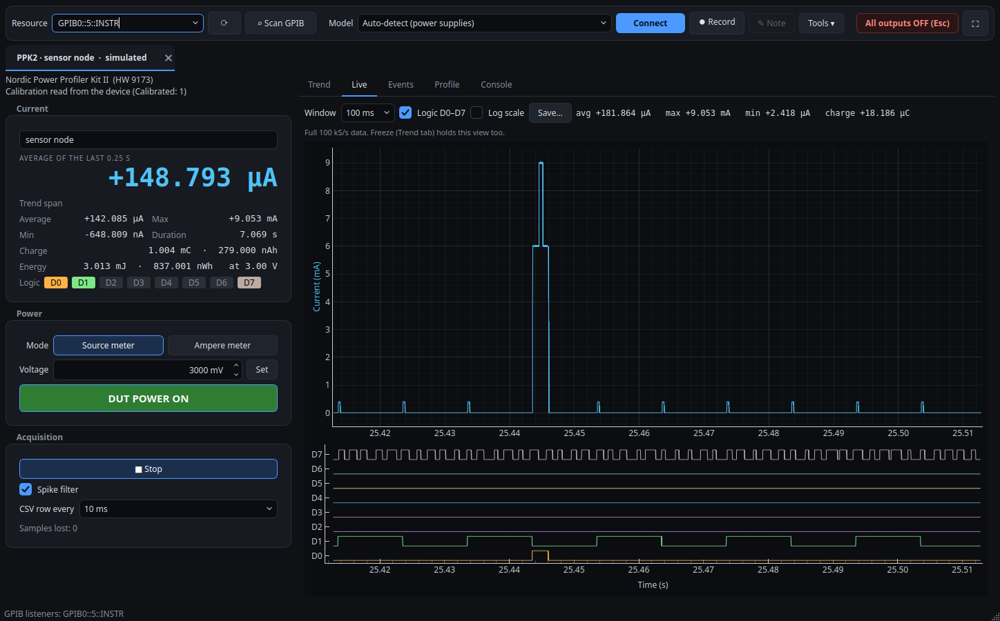

**Live tab.** Every sample of the last 1 ms to 10 s, with optional D0–D7 lanes underneath. **Save…** writes every sample in the window to CSV. **Freeze** (Trend tab) holds this view too.

**Acquisition**

- **Stop / Run** stops and restarts the sample stream.
- **Spike filter** smooths the 3 samples after each automatic shunt-range switch, as nRF Connect Power Profiler does by default. Turn it off to see raw data.
- **CSV row every** sets the CSV recording resolution, from 1 ms to 1 s. Each row holds the average, min and max over that interval. Use **Live ▸ Save…** for full-rate data.
- **Samples lost** counts gaps in the PPK2's sample counter. It should stay at 0.

**Console:** raw command bytes in hex (e.g. `0C 01` turns DUT power on). Nothing is read back. Use this only if you know the PPK2's protocol.

## Logic analyzer panel: Saleae and sigrok

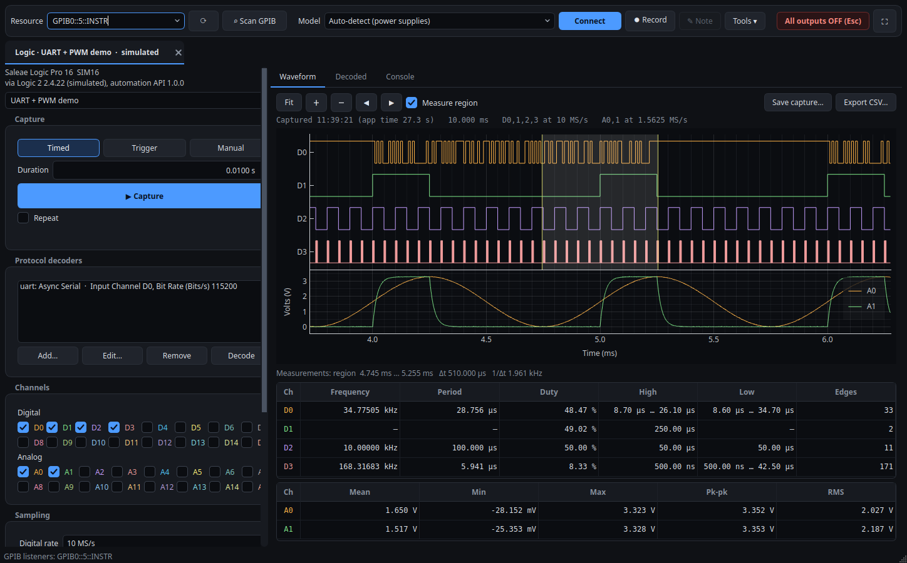

The panel drives a Saleae Logic 8, Logic Pro 8 or Logic Pro 16 through **Logic 2**, which must be running with its automation server on (see Installation). Nothing streams: each **Capture** records once, then shows the result.

**Capture**

- **Timed** records for the **Duration**.
- **Trigger** waits for a **Rising edge**, **Falling edge**, **High pulse** or **Low pulse** on one digital channel, then keeps **Before trigger** seconds from before it and records **After trigger** seconds after. For pulses, **Pulse width** limits which pulses count (0 = no limit). The trigger is at **0 s** on the time axis (dashed line).
- **Manual** records until you press **■ Stop** (✕ throws the capture away).
- **▶ Capture** starts; while a timed or triggered capture runs the same button reads **✕ Abort**. **Repeat** starts the next capture as soon as one is shown, like a scope's Normal mode. **Esc** aborts.

**Channels and Sampling.** Tick the digital (D) and analog (A) inputs to record. Logic 2 refuses rates the analyzer can't reach with that many channels on; the reason appears in the console and status bar. **Threshold** (Pro models only) sets the logic level.

**Waveform tab.** Digital lanes on top, analog traces underneath, on one time axis. Drag to pan and scroll to zoom (or use **Fit ＋ － ◀ ▶**, which also work on a touch screen). Wherever there are more edges than pixels, a lane is drawn as a solid band, so a fast clock reads as a block and a single glitch never vanishes.

The tables under the plot measure **what's in view**, or the band when **Measure region** is ticked (its width shows as Δt and 1/Δt):

- Digital: **Frequency** and **Period** (from rising edges), **Duty** (time high ÷ window), **High** and **Low** pulse widths (shortest … longest, counting only pulses that start and end in the window), and **Edges**.
- Analog: **Mean, Min, Max, Pk-pk, RMS**.

**Save capture…** saves it in the analyzer software's own format: `.sal` for Logic 2, `.sr` for sigrok (opens in PulseView). **Export CSV…** writes `digital.csv` (and `analog.csv`) into a folder you choose.

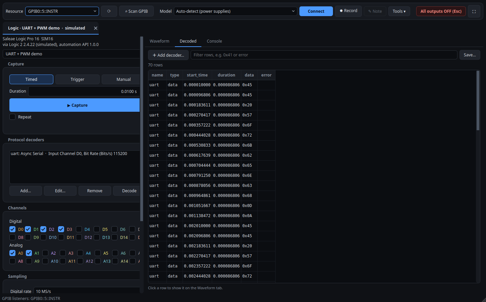

**Protocol decoders** are Logic 2's analyzers. **Add…** picks **Async Serial**, **I2C** or **SPI** and their channels (and bit rate), or **Other…** for any analyzer Logic 2 has (CAN, 1-Wire, …): type its name and settings as JSON, exactly as Logic 2's Add Analyzer panel spells them. Decoders run after every capture. **Decode** (or changing the list) re-runs them on the last capture without capturing again.

**Decoded tab.** Logic 2's data table for all decoders, in time order. Type in **Filter** to narrow it (e.g. `0x41`, or `error`). Click a row to jump to it on the Waveform tab. **Save…** writes the whole table to CSV.

The capture stays open in Logic 2 until the next one or until the tab closes, so you can also look at it in Logic 2 itself.

### sigrok analyzers

The same panel drives any logic analyzer sigrok supports (`SIGROK::…` resources; see Installation), including on the Raspberry Pi. The differences:

- Digital channels only, named as sigrok names them (D0…D7 on most).
- Triggers: **Rising**, **Falling** or **Any edge**, **High** or **Low level**. sigrok triggers in software, checking from the very first sample, so if the trigger comes sooner than **Before trigger** after the start you get less pre-trigger data than you asked for. The time axis still puts the trigger at 0 s.
- Decoders are sigrok's: **UART** (rx, baud rate), **I2C** (scl, sda), **SPI** (clk, mosi, miso, cs), or **Other…** with a sigrok decoder ID from `sigrok-cli -L` and its options as JSON, channels by name, e.g. `{"data": "D2"}` for `onewire_link`.
- The longest capture is 400 M samples (e.g. 16 s at 24 MS/s). Cheap fx2lafw analyzers can't always keep up at 24 MS/s with many channels on; if one stops early, the console says "Device only sent … samples".

### Lining a capture up with a PPK2

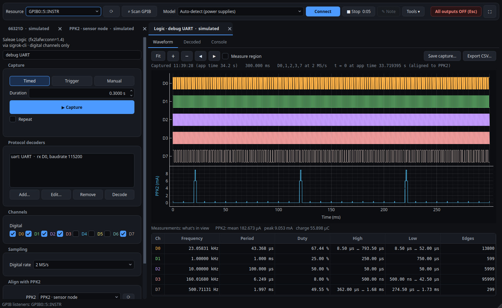

The logic analyzer and the PPK2 each have their own clock. To see exactly which bytes on a bus a current spike belongs to, give them one signal in common:

1. Wire a DUT pin to a logic-analyzer channel **and** to one of the PPK2's logic inputs (D0–D7 on its header). A UART TX line or a debug pin the firmware toggles works well. A plain square wave doesn't: every period fits equally well, and the app warns about that.
2. Keep the PPK2 running (▶ Run on its tab).
3. In **Align with PPK2**, pick the PPK2 tab and the **Shared signal**: the analyzer channel ↔ the PPK2 input.

Every capture is then matched edge for edge against the PPK2's record. The note under the controls says how many edges matched, e.g. "✓ 300 of 300 edges match, ±5 µs". The PPK2's current for the capture's time span appears as a plot under the lanes, on the same axis. The measurement line adds its **mean**, **peak** and **charge** over the view or the region, which gives the charge one transaction costs. **Align now** tries again on the last capture.

The accuracy is about ±5–10 µs, which is the PPK2's 10 µs sample period. The logic analyzer's own timing is much finer. Matching needs a few edges the PPK2 can see apart, at least 20 µs between them.
## Function generator panel

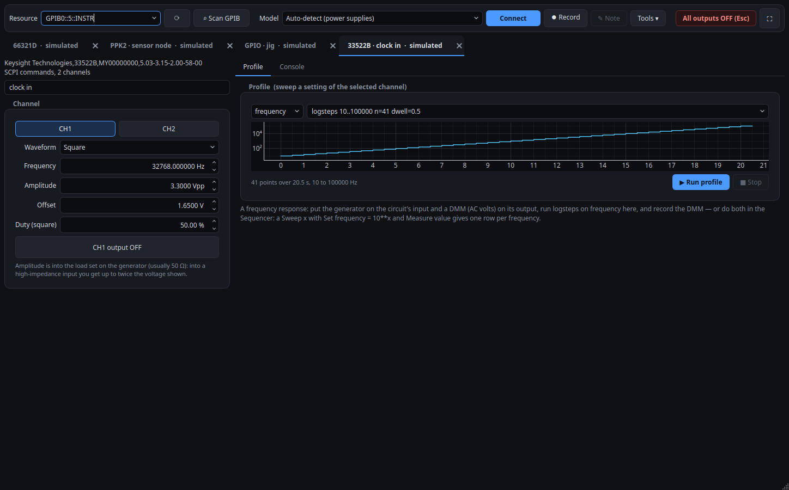

Bench function generators reached over LAN, USB-TMC or GPIB (`FGEN`; see [Hardware](01-hardware-and-resources.md#function-generators) for models and [Installation](02-installation.md#function-generators-optional) for resource names). The app reads the generator's settings on connect and never changes an output by connecting.

| Control | What it does |
|---|---|
| **CH1 / CH2** | Which channel the controls below show and set. A **●** marks a channel whose output is on. Single-channel generators show only CH1. |
| **Waveform** | Sine, Square, Ramp, Pulse, Noise or DC. |
| **Frequency** | Hz. Type a value and press Enter (or leave the box). |
| **Amplitude** | Volts peak-to-peak **into the load set on the generator** (usually 50 Ω): into a high-impedance input the voltage is up to twice what it says. Change the generator's output-load setting to High Z if that's your case. |
| **Offset** | DC offset, V. |
| **Duty (square)** | %, for square and pulse waveforms. |
| **CH*n* output** | Switches the shown channel's output (two taps on a touch screen). Red while on. **Esc** turns every channel of every generator off. |

**Profile tab.** Sweeps frequency, amplitude, offset or duty of the selected channel over time; see [Profiles](#profiles-varying-a-setpoint-over-time). `logsteps 10..100000 n=41 dwell=0.5` is a 41-point logarithmic frequency sweep, half a second per point.

**Console.** SCPI to the generator, e.g. `SOUR1:FREQ 1000` and `SOUR1:FREQ?` (Siglent: `C1:BSWV FRQ,1000` and `C1:BSWV?`). **Send + read** reads the reply.

## GPIO panel (Raspberry Pi header)


On a Raspberry Pi the 40-pin header shows up as `GPIO::/dev/gpiochip…` in the resource list (`SIM::GPIO` simulates one anywhere). Use the pins to press a DUT's buttons, switch a relay (power-cycle the DUT, connect a load), drive a reset line, or wait for a "done" pin. See [Hardware](01-hardware-and-resources.md#raspberry-pi-gpio-header) for wiring and limits.

Each row is one header pin, numbered by its **GPIO** (BCM) number with the physical **Pin** next to it (ⓘ marks pins with a second job such as I²C or the serial console):

| Column | |
|---|---|
| **Name** | What the sequencer, scripts, the watchdog and the CSV call it, e.g. `relay`, `reset`, `done`. Names must be unique. Without one, a pin is `GPIO17`. |
| **Mode** | **Off** (left alone: the app doesn't touch it), **Output** or **Input**. |
| **Pull** | Inputs: none, up or down (the Pi's internal ~50 kΩ resistors). |
| **Active low** | "On" drives the pin **low**, and an input reads 1 when the pin is low. Most relay boards switch on with a low input. |
| **State** | Outputs: a button showing **ON** / off; press it to switch. Inputs: **HIGH** / low, updated 20 times a second. |
| **Pulse** | Inverts an output for the **Pulse** length (top right, default 0.1 s), then puts it back: a button press, a reset pulse. |

**Only pins in use** hides the Off pins. **All outputs off** (and **Esc**) makes every output inactive, which with Active low means *high*: the relay drops out.

**Levels tab.** Every pin in use as a lane on a scrolling trend, with **● Record CSV** (one column per pin) like the other tabs. Pins are released when the tab closes; they go back to being inputs.

> **3.3 V only.** Never connect 5 V to a header pin. An output can drive a few milliamps: use a transistor, MOSFET or relay board for anything more. See [Hardware](01-hardware-and-resources.md#raspberry-pi-gpio-header).

## Profiles: varying a setpoint over time

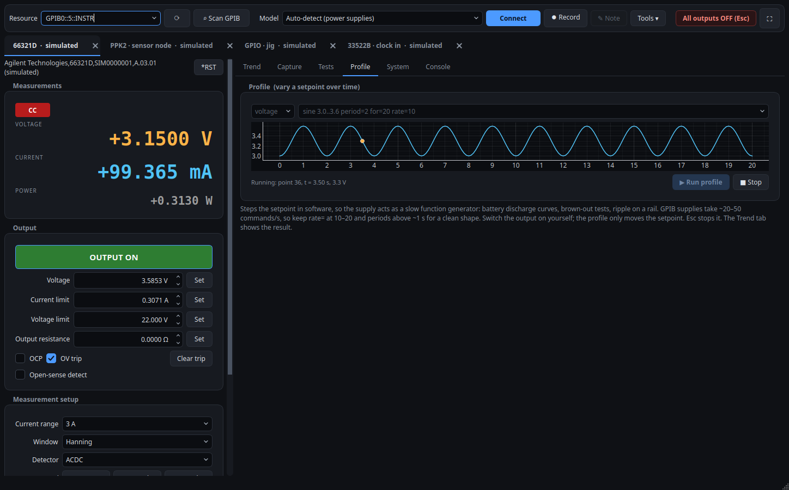

The **Profile** tab of a supply, a PPK2 and a function generator steps a setpoint through a shape in software, which turns a supply into a slow function generator: battery discharge curves, brown-out and ripple tests, a slow frequency sweep. The same text works in the sequencer's **Profile** step and in scripts (`bench.profile(...)`).

| Profile | Meaning |
|---|---|
| `sine 3.0..3.6 period=2 for=20` | A sine between 3.0 and 3.6, 2 s period, for 20 s. It starts at the low end. |
| `triangle 1.8..3.6 period=4 cycles=3` | Three 4 s triangles (`cycles=` instead of `for=`). |
| `square 3.0..3.3 period=1 duty=25 for=10` | 25 % of each second at 3.3, the rest at 3.0. |
| `ramp 0..5 for=10` | 0 to 5 over 10 s, then stays at 5. |
| `steps 1.8..3.6 n=7 dwell=2` | Seven equal steps, 2 s each. |
| `logsteps 10..100000 n=41 dwell=0.5` | Log-spaced steps, for frequency sweeps. |
| `list 3.0 3.3 3.6 3.3 dwell=1` | These values, 1 s each. |
| `csv /home/me/profile.csv` | Rows of `time_s, value` (a header line and `#` comments are skipped). |
| `… rate=20` | For sine, triangle, square and ramp: setpoint updates per second (default 10). |

Pick what to vary (supply: voltage or current limit; PPK2: voltage; generator: frequency, amplitude, offset or duty), type or pick a profile, and the preview shows its shape, number of points, length and range. **▶ Run profile** starts it; a dot follows along the preview. **■ Stop** or **Esc** stops it where it is.

- Each point is sent at its scheduled time and the next waits for the last to be done. If the instrument is slower than the profile, points are skipped rather than falling behind, so the timing stays right and the shape gets coarser. GPIB supplies manage roughly 20–50 setpoints a second: keep `rate=` at 10–20 and periods above about 1 s for a clean shape.
- A profile only moves the setpoint. **Switch the output on yourself.** Watch the result on the **Trend** tab, or record a session.
- A supply's **current** profile changes the current *limit*, which only shapes the current while the supply is in CC.

## PPK2 Events tab


Finds every burst in the PPK2's current (radio transmissions, sensor wake-ups, flash writes) and describes each.

1. Pick the **Data**: the **Live buffer** (the last 10 s, every 10 µs sample, which catches bursts down to tens of µs) or the **Trend span shown** (up to 16 min back, at 1 ms averages).
2. Set **Above** (the threshold, mA), **merge gaps <** (bursts closer than this are one event) and **ignore <** (drop shorter events: spikes, noise).
3. **Find events**.

The summary line gives the count, the average length and charge per event, the total, the highest peak, how often they happen and the average current *between* events (the sleep current). The table lists each event's start, duration, peak, average and **charge** (sortable: click a heading). Select one to see its waveform on the right, with the threshold as a dashed line. **Histogram of** shows how duration, charge, peak, average or the interval between events are spread: two clusters of charge usually mean two different kinds of event. **Save CSV…** writes the table.

**Bus traffic per event.** When a logic-analyzer tab holds a capture [aligned to this PPK2](#lining-a-capture-up-with-a-ppk2), the last column lists the decoded rows that fall inside each event (±50 µs), e.g. `uart 0x41 0x54` or `i2c read 0x48`. That tells you what each burst *is*. An unaligned capture is ignored, and the summary says so.

The search ends events with 10 % hysteresis, so a burst that dips just under the threshold for a moment still counts as one event.

## Sequencer


**Tools ▾ → Sequencer…** runs a test across the open instruments. Each step is one row:

| Action | Instrument | Setting / quantity / pin | Value |
|---|---|---|---|
| **Set** | supply, PPK2, function generator, GPIO | supply: `voltage`, `current` (limit), `output`, `ovp`, `sense_protect` (open-sense detection on / off; 66321D family only). PPK2: `voltage`, `output` (DUT power). Generator: `function`, `frequency`, `amplitude`, `offset`, `duty`, `output`. GPIO: a pin's name. | the value, or `on` / `off`. Generator `function`: `sine`, `square`, `ramp`, `pulse`, `noise`, `dc`. GPIO: `on`, `off` or `pulse 0.1` (seconds). |
| **Wait** | | | seconds |
| **Measure** | supply, DMM, PPK2, GPIO | supply: `voltage` `current` `power` `dvm`. DMM: `value`. PPK2: `current` (mean), `peak`, `charge`. GPIO: a pin (0 / 1). | seconds to average over (blank: one fresh reading) |
| **Capture** | logic analyzer | | (uses that tab's settings and decoders); the column is the number of decoded rows |
| **Profile** | supply, PPK2, function generator | what to vary: `voltage`, `current`; generator `frequency` … | a [profile](#profiles-varying-a-setpoint-over-time), e.g. `ramp 3.0..3.6 for=10`. The step ends when the profile does. |
| **Wait for** | GPIO | an input pin | the level: `1` / `0` / `high` / `low`, optionally `timeout=10` (default 60 s). Fails if the pin doesn't get there in time. With a **Results column**, records how long it took. |
| **Note** | | | text; `{x}` and `{i}` are filled in. It goes into the session being recorded. |

**Run once**, **Repeat** N times, or **Sweep x** from / to / step. Values can be expressions in `x` (the sweep value), `i` (the pass, from 0), `n` and math functions, e.g. `x`, `x / 2`, `3.3 + 0.1 * i`, `10 ** x` (a log sweep: x from 1 to 5 is 10 Hz to 100 kHz). Each pass adds one row to **Results**: the measured values (named by **Results column**, or automatically). Plot any column against another, and **Save CSV…**.

### Limits: pass / fail

Give a **Measure**, **Capture** or **Wait for** step a **Min** and/or a **Max** (either may be blank; expressions in `x` work, e.g. `x * 0.95`). A pass whose values are all within their limits is **PASS**; otherwise it's **FAIL**, and the failing value is listed in a `failures` column (e.g. `I_sleep=1.23e-05 (want ≤ 1e-05)`). Failing rows are shaded red with the failing cell darker; the status line counts them (**5 PASS, 2 FAIL**). With **Stop on first fail** ticked, the run ends at the first failing pass (and outputs go off if **Outputs off at the end** is ticked). Rows without limits have no verdict.

Typical limits: sleep current `Max 10e-6`; regulator output `Min 3.234 Max 3.366` (3.3 V ±2 %); boot time with **Wait for** done `Max 0.5`; "the DUT answered on the UART" as **Capture** with `Min 1`.

### Running

Commands go through each instrument's own tab, in turn with its polling, so the tabs keep showing what happens. **■ Stop** or **Esc** ends a sequence at the next step or wait. With **Outputs off at the end** ticked, every supply output, PPK2 DUT power, generator output and GPIO output is turned off whenever it ends, however it ends. The steps are saved when you run them and come back next time. **Save… / Load…** keep other sequences as JSON; a [setup](#setups-the-whole-bench-by-name) saves the sequence with the rest of the bench.

**Report…** saves this run as an HTML or PDF [report](#reports).

### Script tab

Tick **Run the script instead of the steps** to run Python against the same `bench` object. `math`, `time` and `np` are ready to use and `print` goes to the log.

```python
for v in np.arange(3.0, 3.61, 0.1):
    bench.set("PPK2", "voltage", v)
    bench.wait(0.5)
    i = bench.measure("PPK2", "current", 1.0)
    bench.expect("i_avg", i, hi=0.02)          # makes the row PASS / FAIL
    bench.record(v=round(v, 3), i_avg=i)
```

| Call | Does |
|---|---|
| `bench.instruments()` | the open tabs' names. Anywhere a name is needed, any unique part of it will do (`"66321D"`, `"PPK2"`). |
| `bench.set(name, what, value)` | as the **Set** step (`value` may be `"on"` / `"off"`) |
| `bench.measure(name, what, seconds=0)` | as **Measure**; returns a float |
| `bench.capture(name)` | runs a capture; returns it (`.digital`, `.table_rows`, `.table_header`, `.offset`) |
| `bench.gpio(name, pin, "on" / "off" / "pulse 0.1")` | drive a GPIO output |
| `bench.read_pin(name, pin)` | 0 or 1 |
| `bench.wait_for(name, pin, level=1, timeout=60)` | wait for an input; returns the seconds it took |
| `bench.profile(name, what, text)` | run a profile to the end; returns the number of points sent |
| `bench.expect(label, value, lo=None, hi=None)` | check a limit; returns True / False and makes the next recorded row FAIL if it failed |
| `bench.wait(s)`, `bench.note(text)` | wait (Stop ends it); a note into the session |
| `bench.record(col=value, …)` | one row of results |
| `bench.outputs_off()` | every output off |

The same calls work from outside the app through the [Remote API](#remote-api-python-and-jupyter).

## Watchdog


**Tools ▾ → Watchdog…** holds rules that watch one instrument and act on others, protection no single instrument can give:

- *PPK2 current > 50m for 10 ms → all outputs off* (a shorted DUT)
- *66321D voltage < 2.9 → turn off* the function generator (never drive a DUT's input while it is unpowered)
- *GPIO gpio26 < 0.5 for 500 ms → stop sequence* (an e-stop button with a pull-up)

| Column | |
|---|---|
| **On** | the rule is checked |
| **Instrument**, **Quantity** | what to watch: a supply's `voltage` `current` `power` `dvm`, a PPK2's `current`, a DMM's `value`, a GPIO pin (`gpio26`) |
| **>** / **<**, **Limit** | the limit, with SI suffixes: `50m` = 0.05, `10u` = 0.00001, `3.3` |
| **For (ms)** | how long it must stay past the limit (0: at once) |
| **Then** | **all outputs off** (as Esc), **turn off** the instrument in **Which**, **stop sequence**, or **note only** |

A PPK2 is checked sample by sample (10 µs), so *for 10 ms* means 1000 samples in a row over the limit. Slower instruments are checked per reading: with a hold time, two readings past the limit at least that far apart trip it. A rule that trips is **TRIPPED** (latched) and its action runs once; a message box and the log say what happened, and the event goes into the session being recorded as a note. **Re-arm tripped** after fixing the cause. Untick **Watchdog armed** to suspend every rule.

The rules are kept between runs and saved in [setups](#setups-the-whole-bench-by-name). They work only while the instrument's tab is open and reading (a PPK2 must be running), and they act through the app: the watchdog is a convenience, **not a replacement for the supplies' own current limits and OVP**, which act in hardware within microseconds.

## Math channels

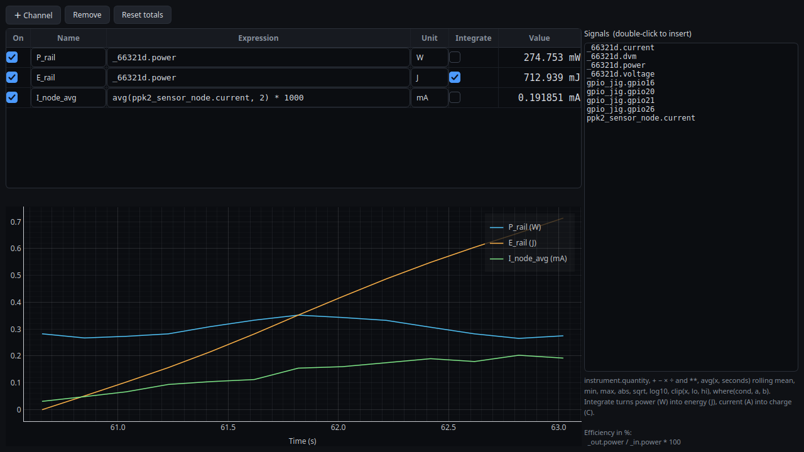

**Tools ▾ → Math channels…** computes traces from the open instruments, live:

| Name | Expression | Unit | Integrate |
|---|---|---|---|
| efficiency | `_66321d_out.power / _6632a_in.power * 100` | % | |
| P_dut | `_66321d.voltage * ppk2.current` | W | |
| E_dut | `_66321d.power` | J | ✓ |
| I_avg | `avg(ppk2.current, 5) * 1000` | mA | |

Signals are named `instrument.quantity`. The instrument part is the tab's name made into an identifier: `66321D · DUT rail` → `_66321d_dut_rail` (a name may not start with a digit, hence the `_`); an unnamed `PPK2 (PPK2::/dev/ttyACM0)` → `ppk2`. The **Signals** list shows every one that's available; double-click to insert it into the expression you're editing. Quantities are those in each tab's CSV: supply `voltage` `current` `power` `dvm`, PPK2 `current`, DMM `value`, GPIO `gpio17` ….

Functions: `+ - * / **`, `avg(x, seconds)` (rolling mean), `min`, `max`, `abs`, `sqrt`, `log`, `log10`, `exp`, `clip(x, lo, hi)`, `where(condition, a, b)`, `t` (time) and `dt`. **Integrate** turns the result into its running total over time: power (W) into energy (J), current (A) into charge (C). **Reset totals** starts the totals again.

Values update five times a second, on a 50 ms grid over the last minute: each signal is put on the grid (a PPK2's 100 kS/s current is averaged over each grid step, so its bursts count properly, rather than being sampled), then the expression is evaluated. While a session records, the channels are saved into it as the **Math** stream, so the [session viewer](#looking-through-a-session) shows them next to the instruments. Channels are kept between runs and in [setups](#setups-the-whole-bench-by-name).

## Reports

A **report** is one page with everything about a test, as **HTML** (a single file that opens in any browser, plots included) or **PDF** (needs WeasyPrint, which the setup scripts install; see [Installation](02-installation.md#pdf-reports)).

- **Sequencer → Report…**: title, date, computer; a **PASS** / **FAIL** badge with the counts; every instrument with its identification; plots of the measured columns against `x` (or the pass); the results table with failures shaded; the sequence itself (steps with limits, or the script); and the log.
- **Session viewer → Report…**, or **Tools ▾ → Session report…** for any `.eewb`: the instruments, one plot per signal over the stretch shown (or the whole session) with notes as dashed lines, the sequencer results, the notes and the logic captures.

**Open it** opens the saved report in your browser. Plots keep their spikes (each is drawn from a min/max envelope).

## Setups: the whole bench by name

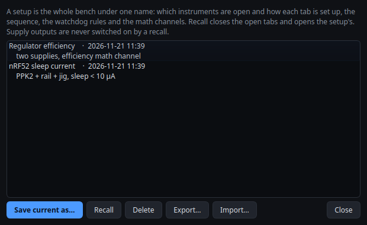

**Tools ▾ → Setups…** saves the whole bench under a name, like "nRF52 sleep current" or "Regulator efficiency", and brings it back in one step:

- which instruments are open, and each tab's settings (names, DMM function and range, decoders and alignment, PPK2 mode, GPIO pin modes and names …),
- the sequence (steps, limits, sweep, script),
- the watchdog rules, and
- the math channels.

**Save current as…** asks for a name and an optional description. **Recall** (or double-click) closes the open tabs and opens the setup's. **Export… / Import…** move a setup to another computer as a JSON file. Setups live in `~/.config/ee-workbench/setups/`.

A recall **never switches an output on** and doesn't send supply setpoints (they're read from the supply, as always): put the setpoints in the sequence's first steps.

## Remote API: Python and Jupyter

**Tools ▾ → Remote API** (or `api = true` in [config.toml](#instruments-at-start-up), or `./run.sh --api`) lets Python outside the app drive the open instruments: a Jupyter notebook, pytest, a CI job. The calls are those of the [Script tab](#script-tab), carried out through the tabs as usual, so you watch it happen on screen and Esc still stops everything.

```python
import sys; sys.path.insert(0, "/home/me/ee-workbench")    # where the project is
from ee_workbench.client import connect

bench = connect()                       # finds the running app
bench.instruments()                     # ['66321D (GPIB0::5::INSTR)', 'PPK2 · node', 'GPIO']
bench.set("66321D", "voltage", 3.3)
bench.set("66321D", "output", "on")
bench.gpio("GPIO", "reset", "pulse 0.05")
t = bench.wait_for("GPIO", "done", 1, timeout=5)
i = bench.measure("PPK2", "current", 2.0)
assert bench.expect("sleep", i, hi=10e-6)
cap = bench.capture("Logic")            # {'header': [...], 'rows': [...], 'offset': ..., 'span': [a, b]}
bench.record(boot_s=t, i_sleep=i)       # a row in the sequencer's results and the session
```

`ee_workbench/client.py` needs only the Python standard library, so it works from any Python 3.9+, inside or outside the project's `.venv`; you can copy the one file. A failed call raises `BenchError` with the app's message (e.g. `No open instrument called 'scope'`), and **Esc** in the app ends a call in progress with `stopped`.

The API listens only on `127.0.0.1` (this computer), on port 8765 by default (`api_port` in config.toml). Every request must carry a random token that the app writes, with the address, to `~/.config/ee-workbench/api.json` (readable only by you) when the API starts; `connect()` reads it from there. To reach a bench Pi from your desk computer, tunnel the port over SSH, `ssh -L 8765:127.0.0.1:8765 pi@bench-pi`, and copy its `api.json` across (or pass `connect(url, token)`). The protocol is documented in the [Technical Reference](04-technical-reference.md#remote-api-apipy-clientpy).

## Sessions: everything in one file

**⏺ Record** in the top bar asks for a file name and then records, into one session file (`.eewb`):

- every open instrument's readings, in the same columns as its CSV (the PPK2 as 1 ms average/min/max rows),
- every logic-analyzer capture: the traces, the decoded table, and its time (to µs if it was aligned to a PPK2),
- the sequencer's results (with PASS / FAIL), the [math channels](#math-channels), watchdog trips, and
- **✎ Note** text (Ctrl+M), stamped with the moment you pressed it.

Instruments opened while recording join in. **■ Stop** closes the file and offers to open it. Recording into an existing file adds to it on the same time base.

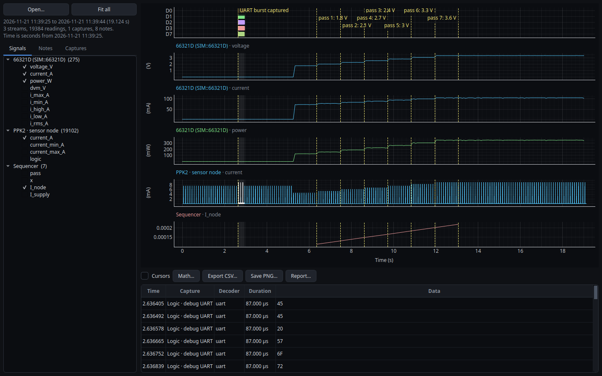

**Tools ▾ → Open session…** opens the viewer. Everything sits on one time axis, in seconds from the start of the session, with the wall clock under the plots:

- **Signals:** tick the columns to plot, one plot each.
- Captures appear as lanes at the top, at the moment they were taken, and as a shaded band on every other plot. An aligned capture also carries the PPK2's full 10 µs samples for its span, drawn in white over the 1 ms trend:

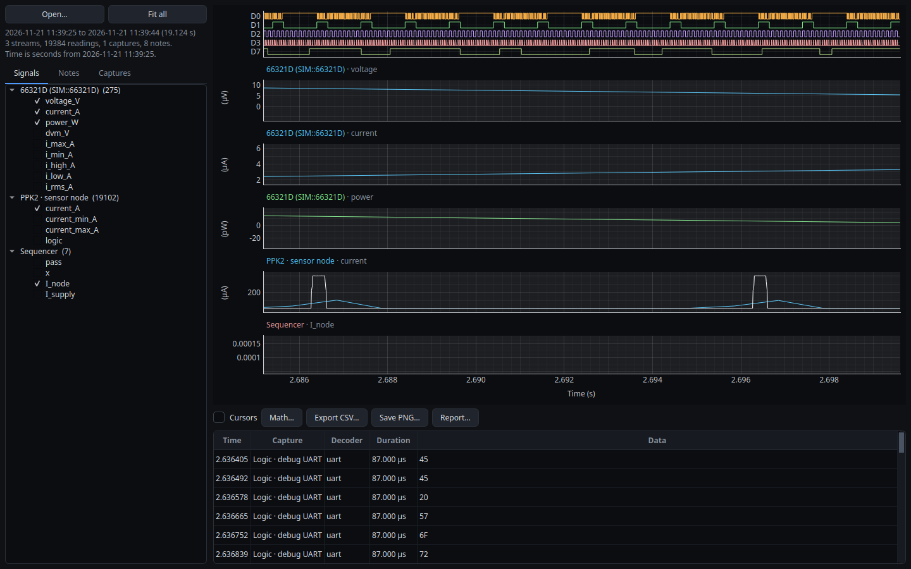

- **Notes** are dashed yellow lines. The **Notes** and **Captures** lists jump to each one.
- The table holds the decoded data of every capture in time order. Click a row to zoom to it.

A session file is a plain SQLite database, so other tools can read it too: `sqlite3 bench.eewb ".tables"`. The [Technical Reference](04-technical-reference.md#session-files-sessionpy) lists its tables.

### Looking through a session


The buttons above the table:

- **Cursors** puts two vertical cursors, **A** (orange) and **B** (blue), across every plot. Drag either. The line beside the buttons gives their times, **Δt** and **1/Δt**; the table under the plots gives, for every plotted signal, its value **at A** and **at B**, **B − A**, the **mean** and **min … max** between them, and for currents and powers the **charge** (C) or **energy** (J) between them. Put A and B around one radio event to read its charge, or across a whole day for the battery budget.
- **Math…** adds a trace computed from the recorded signals, with the same expressions as [Math channels](#math-channels), e.g. `_66321d.voltage * ppk2.current`, or regulator efficiency from two supplies. Tick **Integrate** for energy or charge. It appears under **Signals** like any other and can be exported; it isn't written into the file.
- **Export CSV…** writes every ticked signal over the **stretch shown** (zoom first) as `t_s, time, stream, column, value`.
- **Save PNG…** saves the plots as you see them.
- **Report…** makes an [HTML / PDF report](#reports) of the stretch shown, with the ticked signals.

## Workflows

### Monitoring an E3610A (or any manual supply)

1. Connect the 3456A's HI/LO inputs to the E3610A's output terminals.
2. Open the 3456A: choose model **HP 3456A DMM** and address `GPIB0::22::INSTR`, then **Connect**.
3. Set the channel name to "E3610A output", the function to **DCV**, and integration to **1 PLC**.
4. Press **● Record CSV** to log for as long as you need.

### Battery-life (current-profile) logging with the 66321D

1. Set the voltage to the battery voltage (e.g. 3.8 V), with a current limit above the device's peak current.
2. Optionally set the **output resistance** to match the battery (e.g. 0.1 Ω).
3. Choose **Smooth** speed, the **ACDC** detector, and tick **Pulse statistics**.
4. **Record CSV**, then read the average current and the **charge** total off the trend.

### Measuring a battery-powered device's average current with the PPK2

1. Wire the PPK2 as a **source meter** (VOUT and GND to the DUT's battery terminals, battery removed) and set the voltage to the battery's nominal voltage, e.g. 3000 mV for a coin cell.
2. Turn **DUT POWER** on. Wait for the device to settle into its normal duty cycle.
3. Choose a **Span** that covers several cycles (e.g. 2 min), or tick **Measure region** and drag over exactly one or more whole cycles.
4. Read **Average**. Battery life ≈ capacity ÷ average current, e.g. 220 mAh ÷ 15 µA ≈ 14,700 h. **Charge** per cycle tells you which events dominate.

### Checking a UART against a power event (logic analyzer with a supply or PPK2)

1. Open the supply (or PPK2) and the logic analyzer. Connect the DUT's TX to D0.
2. Add a UART (**Async Serial** on a Saleae) decoder on D0 at the DUT's baud rate.
3. Choose **Trigger** on D0, **Falling edge** (the first start bit), with 10 ms **Before trigger**. Press **▶ Capture**, then switch the DUT on.
4. The Decoded tab shows the boot message. The status line gives the capture's app time, so you can find the same moment on the supply's trend. With a PPK2, also wire TX to a PPK2 logic input and set **Align with PPK2**: the current then appears right under the bytes, to within a few µs.

### Current per radio packet, swept over supply voltage

1. Open the PPK2 (source meter, DUT power on) and the logic analyzer. Wire the radio's "TX active" debug pin to analyzer D1 and PPK2 D1, and set **Align with PPK2** to D1 ↔ PPK2 D1.
2. Press **⏺ Record** to keep everything in a session.
3. In the sequencer: **Sweep x** from 1.8 to 3.6 step 0.2 with *Set PPK2 voltage x*, *Wait 1*, *Measure PPK2 current 5* (column `I_avg`), *Capture Logic*.
4. Stop the session and open it: each capture sits on the current trace, and the results table gives the average current against voltage.

### Characterizing a regulator with two supplies and the DMM

Use the 66321D as the input supply, the 6632A as a second rail, and the 3456A on the output. All three trends share one time axis. Record a CSV from each tab and join them on `t_s`.


### Production-style test with pass / fail

1. Open the supply (or PPK2) powering the DUT, the DMM, and anything else the test needs. Name the tabs ("DUT rail", "3V3 out").
2. In the sequencer: *Set DUT rail voltage 5*, *Set DUT rail output on*, *Wait 0.5*, *Measure 3V3 out value* with **Min** `3.234` **Max** `3.366`, *Measure PPK2 current 2* with **Max** `10e-6` (sleep current), *Capture Logic* with **Min** `1` (it said hello on the UART).
3. **Repeat** 1 time per board, tick **Stop on first fail** and **Outputs off at the end**.
4. **Run** for each board; the status line says PASS or FAIL. **Report…** gives a PDF per board, or **Save CSV…** at the end of the batch.
5. **Tools ▾ → Setups… → Save current as…** "Board test", so tomorrow it's one click.

### Automating a DUT with the Pi's GPIO

Wire GPIO16 to the DUT's reset (through a transistor if the DUT isn't 3.3 V), GPIO21 to a "boot done" pin the firmware raises, and a relay board on GPIO20 to switch the DUT's battery input. In the GPIO tab name them `reset`, `done` (Input) and `relay` (Output, Active low for most relay boards). Then:

| Action | Instrument | Setting | Value | Max | Results column |
|---|---|---|---|---|---|
| Set | GPIO | relay | on | | |
| Set | GPIO | reset | pulse 0.05 | | |
| Wait for | GPIO | done | 1 timeout=5 | 0.8 | boot_s |
| Measure | PPK2 | current | 2 | 15e-6 | I_idle |
| Set | GPIO | relay | off | | |

**Repeat** 100 times makes a power-cycling soak test with boot time and idle current per cycle.

### Brown-out and supply-ripple tests with a profile

1. Open the supply powering the DUT and a logic analyzer (or GPIO input) on a pin that shows the DUT is alive.
2. **Profile** tab: `ramp 3.3..1.6 for=60` on voltage. Record a session and watch where the alive pin stops: that's the brown-out voltage. `ramp 1.6..3.3 for=60` finds the power-on threshold.
3. For a slow supply-ripple test: `sine 3.0..3.6 period=2 for=120`, and watch the DUT's behaviour or current on the trend.

### Regulator efficiency

Power the regulator's input from the 6632A (named "in") and load its output from the 66321D in CC sink or with a resistor, measuring with the 66321D (named "out"). **Math channels**: `eff = _66321d_out.power / _6632a_in.power * 100` (unit %). In the sequencer, sweep the load (*Set out current x*) and *Measure* both powers; or record a session and use the viewer's cursors on the math trace.

### Frequency response with the function generator and DMM

1. Generator on the circuit's input (sine, the amplitude you want), DMM on its output in **ACV**.
2. Sequencer: **Sweep x** from `1` to `5` step `0.1`; *Set FGEN frequency* `10 ** x`; *Wait 1*; *Measure 3456A value* with column `Vout`.
3. Plot `Vout` against `x` (that's log frequency), and **Report…**.

### From a Jupyter notebook

Switch on **Tools ▾ → Remote API**, then in the notebook `from ee_workbench.client import connect; bench = connect()`, and use the same calls as the Script tab. Results come back as plain numbers and lists, ready for pandas and matplotlib; anything you `bench.record()` also lands in the sequencer's results and the session.

## CSV formats

**Supply tabs:** `timestamp, t_s, voltage_V, current_A, power_W, mode, flags, dvm_V, i_max_A, i_min_A, i_high_A, i_low_A, i_rms_A`

**3456A tab:** `timestamp, t_s, channel, function, value, unit, overload`

**PPK2 tab:** `timestamp, t_s, current_A, current_min_A, current_max_A, logic` (one row per **CSV row every** interval; `logic` is D0–D7 as a byte, with a bit set if that input was high at any point in the interval). **Live ▸ Save…:** `t_s, current_A, logic`, one row per sample.

**Saleae Decoded ▸ Save…:** Logic 2's data-table columns (`name, type, start_time, duration`, then one per decoder field). **Export CSV…** writes Logic 2's own `digital.csv` (one row per change) and `analog.csv`.

**sigrok Export CSV…:** sigrok's `digital.csv`: a time column, then one 0/1 column per channel (one row per sample).

**Sequencer Save CSV…:** `t, pass, x` (sweeps), `result` and `failures` (with limits; `failures` is empty on passing rows), then one column per measurement.

**Capture export:** `t_s, segment, current_A` (or `voltage_V`); the last line, starting with `#`, holds the trigger settings.

**GPIO tab:** `timestamp, t_s`, then one 0/1 column per pin in use, named by the pin's name.

**PPK2 Events ▸ Save CSV…:** `start_s, duration_s, peak_A, mean_A, charge_C, bus` (bus = the decoded rows during the event, ` | `-separated).

**Session viewer ▸ Export CSV…:** `t_s, time, stream, column, value`, one row per reading (long format: filter by stream and column, or pivot).

**Sequencer with limits:** after `x`, a `result` column (`PASS` / `FAIL`), and a `failures` column (what failed, empty on passing rows).

**Tests:** battery life `t_s, voltage_V, current_A, charge_mAh, energy_mWh`; battery emulator `t_s, soc_pct, ocv_V, voltage_V, current_A`; sequencer `t_s, step, set_V, set_A, voltage_V, current_A`; I-V sweep `set, voltage_V, current_A`.

`t_s` is seconds on the app's shared clock and lines up across all files. Empty cells mean that quantity wasn't measured.

## Simulators

Open the resources `SIM::66321D`, `SIM::6632A`, `SIM::3456A`, `SIM::PPK2`, `SIM::SALEAE`, `SIM::SIGROK`, `SIM::FGEN`, `SIM::SDG` and `SIM::GPIO` to try every feature without hardware. The simulated 66321D drives a phone-like load drawing short current bursts. The 6632A drives a 10 Ω resistor. The 3456A reads a slightly drifting 5 V rail, about 1 kΩ, or 120 mV AC. The PPK2 powers a BLE-style sensor: 3 µA asleep, a 400 µA wake-up every 10 ms, and a 6–9 mA radio event every 100 ms (shown on D0). The Saleae is a Logic Pro 16 that needs no Logic 2: D0 sends `EE Workbench\r\n` at 115200 baud every 2 ms, D1 is 1 kHz at 25 % duty, D2 10 kHz, D3 bursts of eight 1 MHz clocks, A0 a 1 kHz sine and A1 the D1 signal through an RC filter. Its Async Serial decoder works on D0. `SIM::SIGROK` is a 16-channel fx2lafw-style analyzer whose D7 carries the same irregular debug pin as the simulated PPK2's D7, so [alignment](#lining-a-capture-up-with-a-ppk2) can be tried. `SIM::FGEN` is a two-channel Keysight 33522B (SCPI commands); `SIM::SDG` a Siglent SDG2042X (Siglent's commands). `SIM::GPIO` is a Pi header wired like a small test jig: GPIO21 reads what GPIO20 drives, GPIO12 reads GPIO16 inverted, and GPIO26 is a button pressed (low) for 0.2 s every 2 s.  is a 16-channel fx2lafw-style analyzer whose D7 carries the same irregular debug pin as the simulated PPK2's D7, so [alignment](#lining-a-capture-up-with-a-ppk2) can be tried.  is a two-channel Keysight 33522B (SCPI commands);  a Siglent SDG2042X (Siglent's commands).  is a Pi header wired like a small test jig: GPIO21 reads what GPIO20 drives, GPIO12 reads GPIO16 inverted, and GPIO26 is a button pressed (low) for 0.2 s every 2 s.

## Instruments at start-up

EE Workbench remembers which instruments were open, and reopens them the next time it starts. Panel settings come back too: the 3456A's channel name, function, range, integration and filter/autozero; GPIO pin modes and names; analyzer decoders. The watchdog rules and math channels are kept too (`~/.config/ee-workbench/bench.json`). For several bench arrangements you switch between, use [setups](#setups-the-whole-bench-by-name). **Supply setpoints and outputs are never restored.** They are always read from the supply itself, so starting the app never changes what a supply is doing.

What happens at start-up is set in `~/.config/ee-workbench/config.toml`. The file is created, with comments, the first time the app runs:

```toml
[startup]
open = "last"        # "last", "list", "scan" or "none"
wait_for_gpib = 30   # seconds to wait for the adapter at boot
api = false          # start the Remote API at start-up (or ./run.sh --api)
api_port = 8765

[[instrument]]
resource = "GPIB0::5::INSTR"
model = "auto"

[[instrument]]
resource = "GPIB0::22::INSTR"
model = "3456A"
name = "E3610A output"
function = "DCV"     # DCV, ACV, ACV+DCV, 2W ohm, 4W ohm, ...
range = "AUTO"       # e.g. "10 V", "10 kohm"
nplc = 1
```

| `open =` | At start-up |
|---|---|
| `"last"` (default) | Reopen whatever was open when the app last closed |
| `"list"` | Always open the `[[instrument]]` entries, whatever was used last |
| `"scan"` | Scan the GPIB bus and open every instrument that answers. A 3456A needs its model in the list, or to have been opened once before, because it can't identify itself. |
| `"none"` | Start empty |

Notes:

- Resources on the command line (`./run.sh GPIB0::5::INSTR`) override the file for that run. `--open last|list|scan|none` overrides just the mode.
- At boot, the app waits up to `wait_for_gpib` seconds for the GPIB adapter before connecting, showing a countdown in the status bar.
- An instrument that doesn't answer (switched off, say) gets a **⟳ Retry** button on its tab. It stays in the session, so it's tried again at the next start. Close its tab to forget it.
- The session is saved within a second of any change, and again on quit, so pulling the power on a Pi loses nothing.
- The remembered session is in `~/.config/ee-workbench/last-session.json`. Delete it to start fresh.

## Touch screens

On a touch screen (or any display of 1280×800 or smaller) the app uses a touch layout: larger controls, a numeric keypad for setpoints, two taps to turn an output on, and an **＋ Add instrument** dialog instead of the toolbar. See *Raspberry Pi & Touch Screen* for details.

## Keyboard and mouse reference

| Action | How |
|---|---|
| All outputs off (and stop a running sequence, profile or remote call) | **Esc** |
| Note into the session being recorded | **Ctrl+M** |
| Full screen on/off | **F11** |
| Apply a setpoint | **Enter** in the box, or **Set** |
| Zoom a plot | mouse wheel over the plot |
| Pan a plot | drag |
| Autoscale / export a plot | right-click the plot |
| Close an instrument | **×** on its tab |
