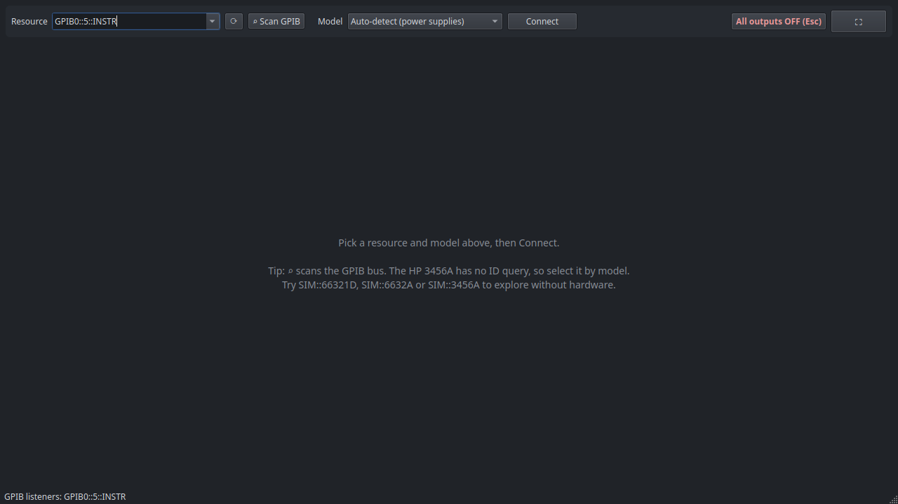
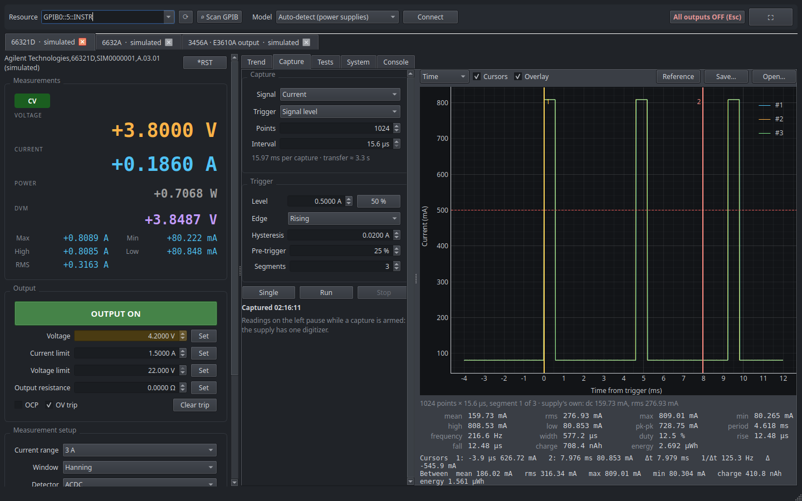
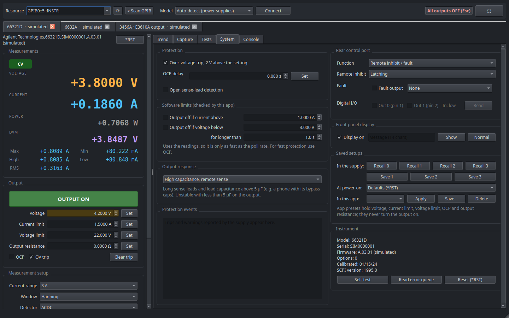

# User's Guide

## Starting up

Run `./run.sh` from the project folder. With no arguments the window opens empty, ready for you to connect.



The **toolbar** along the top is always visible:

| Control | What it does |
|---|---|
| **Resource** | The VISA address, e.g. `GPIB0::5::INSTR`. You can type in the box. |
| **⟳** | Re-list the VISA resources. |
| **⌕ Scan GPIB** | Find every address with an instrument listening. It sends no commands, so it's safe for the 3456A. |
| **Model** | *Auto-detect* identifies the supplies. **Choose HP 3456A by hand.** |
| **Baud** | Appears only for serial (`ASRL…`) resources. |
| **Connect** | Opens the instrument in a new tab. |
| **All outputs OFF (Esc)** | Turns off the output of every connected supply. |

Each instrument gets its own **tab**. Closing a tab disconnects that instrument but leaves its outputs as they are. All tabs share one time axis (seconds since the app started), so you can line up events across instruments.

> **Safety:** **Esc** works from anywhere in the window. It turns *off* the output of every supply and never turns one on. Connecting to an instrument never changes its output; the app reads the current settings first.

## Power-supply panel: Agilent 66321D


### Measurements

- **Mode badge:** **CV** (green, constant voltage), **CC** (red, current limit), **CC-** (sinking current), **OFF**.
- **Flags** (in red) come from the instrument's status register:

| Flag | Meaning | What to do |
|---|---|---|
| OV | Over-voltage trip (output went ~2 V above the setting) | Find what back-drove the output, then **Clear trip** |
| OCP | Over-current protection tripped | Remove the overload or raise the limit, then **Clear trip** |
| OT | Over-temperature | Let it cool; check the airflow |
| SENSE-OPEN | A remote-sense lead is disconnected (when open-sense detection is on) | Check the sense leads, then **Clear trip** |
| FP-LOCAL | The front panel has taken local control | Press the supply's Local key again or send any command |
| RI / INH | Remote inhibit input active | Check the rear INH input |
| UNREG | Output can't regulate | Check the load, sense leads and AC line |
| OVLD | Measurement overload | Use a higher current range |

- **Voltage / Current / Power** readouts. Current switches automatically between mA and A.
- **DVM** shows the rear-panel DVM input when **Read DVM input** is ticked (D models only).
- **Pulse statistics** (when ticked): **Max/Min** are the extremes within one acquisition. **High/Low** are the two levels of a pulsed waveform (for example, transmit burst versus idle). **RMS** is the true RMS current.

### Output

- **OUTPUT ON/OFF** toggles the output. It turns green while the output is on.
- **Voltage, Current limit, Voltage limit, Output resistance:** type a value and press **Enter** or **Set**. A box turns **amber** when its value differs from what the instrument has, meaning "not applied yet". Turning the mouse wheel over a box does nothing unless you've clicked into it first, so scrolling the panel can't change a live setpoint.
- **Output resistance** (−40 mΩ to 1 Ω) makes the supply behave like a battery with internal resistance. Use it to test how a device handles supply droop.
- **Voltage limit** (the 66321D's `VOLT:PROT`) is the highest voltage the supply will *accept as a setting*, from 0 to 22 V. Use it to make sure nobody can program more than your device can take. It doesn't trip anything.
- **OCP** (over-current protection): when ticked, the supply turns its output *off* instead of limiting the current. The **OCP delay** on the System tab sets how long current limit has to last first.
- **OV trip** (over-voltage protection): turns the output off if the output rises about 2 V above the voltage setting, e.g. when a charger or another supply drives it. On by default.
- **Clear trip** resets a latched OV or OCP trip. Remove the cause first.
- **\*RST** returns the supply to its power-on defaults (output off). The app asks you to confirm first.

### Measurement setup and speed

The 66321D digitizes the output and averages each reading over *samples × interval*. Fewer samples give faster updates, more samples give smoother readings. Times measured on the real 66321D over GPIB:

| Preset | Window | V + I + status | Current only |
|---|---|---|---|
| **Fast** (256 samples) | 4 ms | ~21 readings/s *(measured)* | ~32 readings/s *(measured)* |
| **Normal** (1024 samples) | 16 ms | ~13 readings/s | ~20 readings/s |
| **Smooth** (2048 samples, the default) | 32 ms | ~9 readings/s *(measured)* | ~15 readings/s |

- **Measure voltage:** untick it for faster current-only logging. The supply measures voltage and current one after the other, so voltage costs a second acquisition.
- **Pulse statistics** add no extra acquisition. **Read DVM input** adds one.
- **Current range:** **3 A**, **1 A**, or **20 mA** for sleep and standby currents. Pick the lowest range that still covers the *peak* current: a range that's too low clips the bursts and shows **OVLD**. The 66321D has no auto-ranging.
- **Window:** **Hanning** (the default) reduces the error from ripple when an acquisition isn't a whole number of cycles. **Rectangular** gives the plain average of exactly what was sampled.
- **Detector:** **ACDC** measures the whole waveform (use it for pulsed loads); **DC** gives the DC component only.
- **Poll delay:** extra time between readings. Leave it at *none* for maximum speed, or raise it for long logs.

> **Pulsed loads with short windows:** with a bursty load (e.g. 577 µs bursts every 4.6 ms), a 4 ms window catches a different part of each burst every time, so the trend jumps around. Use **Smooth** for a stable average, or the **Capture** tab to see the bursts themselves.

### Trend tab

Strip charts of voltage, current (with the per-reading **max** as a dotted line when pulse statistics are on) and the DVM.

- **Span:** 30 s, 2 min, 10 min, 1 h, or All. **Freeze** pauses the display (data keeps arriving). **Clear** empties the plots.
- The stats line above the plot shows average, minimum and maximum current, average voltage, and the **charge** delivered (mAh/Ah) over the span. Use it for battery-life estimates.
- Drag a plot to pan, use the mouse wheel to zoom, and right-click for export and autoscale options.
- **● Record CSV** writes every reading to a file until you press it again.

### Capture tab



A storage-scope view of the output: up to 4096 points at intervals down to 15.6 µs (a 64 ms window), triggered on the signal itself, with data from *before* the trigger. Use it for transmit bursts, inrush current, wake-ups and load steps.

**Setting up a capture (left side):**

- **Signal:** current or voltage. **Points** and **Interval** set the record; the line under them shows the time covered and how long the transfer takes.
- **Trigger:**

| Trigger | What starts the capture |
|---|---|
| **Immediate** | Pressing **Single** or **Run**. |
| **Signal level** | The signal crossing **Level** on the chosen **Edge** (rising, falling or either). **Hysteresis** is a band around the level the signal must cross completely, so noise doesn't trigger it. **50 %** sets the level halfway between the high and low of the last capture. |
| **External input** | A falling edge on pin 3 of the rear control port. The port must be set to *External trigger*; the tab offers to do it. |
| **Output step** | The supply changes its output to the ticked **Voltage**, **Current limit** and/or **Resistance** values and captures the response at the same instant. **Put the levels back afterwards** restores them when the capture is done. **Step now** changes the levels the same way without capturing. |

- **Pre-trigger:** how much of the record comes before the trigger. 25 % shows what led up to the event; 0 % starts at the trigger.
- **Segments:** capture several triggers in a row (points × segments ≤ 4096). **Overlay** draws them on top of each other, like a scope's persistence.
- **Single** captures once; **Run** repeats until **Stop**. While a level or external trigger waits, the status turns amber. **Stop**, **ALL OFF** and **Esc** abort it.

> Readings on the left pause while a capture is armed: the supply has one digitizer. The 66321D sends array data at about 3.7 KB/s, so 1024 points take about 1.2 s to transfer.

**Reading the result (right side):**

- Time is shown relative to the trigger (dashed line). The red dashed line is the trigger level.
- **Measurements** are worked out automatically from the first segment: mean, RMS, min/max, high/low levels, peak-to-peak, and for pulse trains the period, frequency, pulse width, duty cycle and 10–90 % rise and fall times. For current, the **charge** in the record (in Ah) and the **energy** (Wh, at the present output voltage) are shown too; hover for coulombs and joules. *Supply's own* is the 663xx's own DC and RMS figure for comparison.
- **Cursors** adds two draggable markers. The line under the plot shows each cursor's time and value, Δt, 1/Δt, Δ, and the mean, RMS, min, max, charge and energy *between* them. Use it to measure one burst.
- **View:** **Time**, **Histogram** (share of time spent at each level, useful for sleep/active ratios) or **Spectrum** (FFT with a Hann window, to find ripple and switching frequencies).
- **Reference** keeps the current capture in grey behind the following ones, for before/after comparisons. Press it again to clear it.
- **Save…** writes CSV (`t_s, segment, current_A` or `voltage_V`, with the settings on the last line) or a PNG of the plot. **Open…** loads a saved CSV back for measuring.

### Tests tab


Ready-made procedures. Choose one along the top, set it up on the left, then press **Start**. **Stop**, **ALL OFF** and **Esc** end any test. A test that turns the output on asks you to confirm first. **Save CSV…** writes the test's data.

- **Battery life:** power your device from the supply and log what it uses. It shows elapsed time, average current, **charge** (mAh) and **energy** (mWh), and projects how long a battery of the **Capacity** you enter would last. It stops after the **Duration**, when the **Charge used** limit is reached, or if the voltage falls **below** the cutoff.
- **Battery emulator:** the output behaves like a battery running down. Choose the **Chemistry** (Li-ion/LiPo, LiFePO4, NiMH or alkaline), the number of **Cells** in series, the **Capacity** and the **Start charge**. As the load draws current the charge goes down and the voltage follows that chemistry's discharge curve. The **Internal R** is set as the supply's output resistance, so the voltage also sags under load like a real cell. Negative current (charging) raises the charge. Use a small capacity to run through a whole discharge in minutes. It stops when the battery is empty and puts the output resistance back to 0 Ω.
- **Sequencer:** a table of steps, each with **Volts**, **Amps** (current limit), **Hold s** and **Ramp s**. A non-zero ramp moves smoothly from the previous step's values. **Repeat** runs the whole table several times. **Open…** and **Save…** store sequences as JSON files. The plot shows the set voltage and the measured voltage.
- **I-V sweep:** steps the voltage (with a fixed current limit) or the current limit (with a fixed voltage) through **Points** values from **From** to **To**, waits the **Settle** time at each, and measures. It plots current against voltage and fits a slope (dV/dI). **Sweep back down too** shows hysteresis.

### System tab



The rest of the 66321D's features. Each group appears only on models that have it.

- **Protection:** **Over-voltage trip** (same as **OV trip** under Output), **OCP delay** (0.08 s by default: how long current limit must last before OCP turns the output off; raise it if inrush trips OCP), and **Open sense-lead detection**, which turns the output off if a remote-sense lead comes loose.
- **Software limits:** checked by this app on every reading. They turn the output off if the current stays above, or the voltage stays below, a value for longer than the time you set. They're only as fast as the readings, so use OCP when you need fast protection.
- **Output response:** low or high load capacitance, local or remote sense. **High capacitance, remote sense** suits a phone with its bypass capacitors on long sense leads, but needs more than 5 µF across the output; the app asks before selecting it.
- **Protection events:** trips and warnings the supply reports (over-current, over-voltage, over-temperature, open sense lead, remote inhibit, unregulated, measurement overload), with the time. They also appear in the status bar. The software limits log here too.
- **Rear control port:** choose what pins 1–3 do. With **Remote inhibit / fault**, set the **Remote inhibit** input to latching, live or off, and the **Fault output** and what drives it. With **Digital I/O**, tick **Out 0** and **Out 1** to drive pins 1 and 2, and press **Read** to read the pin 3 input. **External trigger** makes pin 3 the Capture tab's external trigger. The port setting is stored in the supply's non-volatile memory, so the app asks first.
- **Front-panel display:** switch the display off, show a message of up to 14 characters, or press **Normal** to go back to readings.
- **Saved setups:** **Recall 0–3** and **Save 1–3** use the supply's own memories (the app asks first, because a recalled setup can turn the output on). **At power-on** chooses between defaults and saved setup 0. **In this app** keeps named presets of voltage, current limit, voltage limit, OCP and output resistance in `~/.config/ee-workbench/presets.json`; applying one never turns the output on.
- **Instrument:** model, serial number, firmware, options and calibration date. **Self-test** runs the supply's self-test, **Read error queue** shows any errors waiting, and **Reset** sends `*RST`.

### Console tab


Type any command (SCPI for the 66321D, e.g. `MEAS:CURR:ACDC?`) and press **Enter**. Queries (ending in `?`) show the reply. **Trace GUI commands** logs every command the app sends, which is handy for learning the command set or writing your own scripts. Instrument errors appear here too, prefixed with ⚠.

## Power-supply panel: HP 6632A


It works the same way as the 66321D panel, with these differences:

- **Setpoints can't be read back.** The 6632A has no way to report its programmed voltage or current. The boxes start amber ("unknown") and the output shows **OUTPUT ?** until you set them. After that they show what this app sent. Changes made on the front panel aren't seen.
- To keep a stray **Set** from causing harm, the OVP box starts at its maximum (22 V). Programming OVP below the output voltage fires the 6632A's crowbar, which shorts the output.
- **Clear trip** sends `RST` (resets a latched OV or OC). The reset button sends **CLR**, which returns the supply to its power-on defaults. **This turns the output ON at 0 V**, and the confirmation dialog says so.
- It has no measurement setup, Capture or System tab, DVM or output resistance. The **Tests** tab works, except for the battery emulator's internal resistance. **Measure voltage** can still be unticked to speed up current logging.
- The minimum current limit is 20 mA. Lower values are raised to 20 mA, as the supply itself does.

## Multimeter panel: HP 3456A


- **Channel name:** label the reading (e.g. "E3610A output"). The name appears on the tab, the plot axis and in the CSV.
- **Function:** DCV, ACV, ACV+DCV, 2W Ω, 4W Ω, offset-compensated (OC) 2W/4W Ω, or DCV/DCV ratio.
- **Range:** AUTO or a fixed range. Fixed ranges are faster and avoid range-switching glitches in logs.
- **Integration** (power-line cycles, PLC). Rates are *estimates* for 60 Hz mains. The **readings/s** counter shows the real rate.

| Setting | Use for | Approximate rate (autozero on) |
|---|---|---|
| 0.01 PLC | fast changes, 4½ digits | ~25/s (limited by the bus) |
| 0.1 PLC | general logging | ~20/s |
| 1 PLC | 6½ digits, rejects mains hum | ~12/s |
| 10 PLC | low-noise measurements | ~3/s |
| 100 PLC | lowest noise | one reading every ~3.4 s |

- **Autozero** re-measures the zero offset on every reading, which halves the speed. Turn it off for speed on short runs.
- **AC filter** smooths noisy DC signals but adds settling time.
- **Null** stores the next reading and subtracts it from all later ones. Short the leads, press **Null**, then measure. Changing function or null state clears the trend, because mixing units or offsets in one trace would be meaningless.
- **Statistics** (mean, standard deviation, min, max, peak-to-peak, count) cover the span shown in the trend.
- **OVLD** means the input is beyond the selected range.
- **Console:** send raw 3456A program codes (e.g. `F1 R4 T3`). **Send + read** fetches one reading afterwards.

## Workflows

### Monitoring an E3610A (or any manual supply)

1. Connect the 3456A's HI/LO inputs to the E3610A's output terminals.
2. Open the 3456A: choose model **HP 3456A DMM** and address `GPIB0::22::INSTR`, then **Connect**.
3. Set the channel name to "E3610A output", the function to **DCV**, and integration to **1 PLC**.
4. Press **● Record CSV** to log for as long as you need.

### Battery-life (current-profile) logging with the 66321D

1. Set the voltage to the battery voltage (e.g. 3.8 V), with a current limit above the device's peak current.
2. Optionally set the **output resistance** to match the battery (e.g. 0.1 Ω).
3. Choose **Smooth** speed, the **ACDC** detector, and tick **Pulse statistics**.
4. **Record CSV**, then read the average current and the **charge** total off the trend.

### Characterizing a regulator with two supplies and the DMM

Use the 66321D as the input supply, the 6632A as a second rail, and the 3456A on the output. All three trends share one time axis. Record a CSV from each tab and join them on `t_s`.

## CSV formats

**Supply tabs:** `timestamp, t_s, voltage_V, current_A, power_W, mode, flags, dvm_V, i_max_A, i_min_A, i_high_A, i_low_A, i_rms_A`

**3456A tab:** `timestamp, t_s, channel, function, value, unit, overload`

**Capture export:** `t_s, segment, current_A` (or `voltage_V`); the last line, starting with `#`, holds the trigger settings.

**Tests:** battery life `t_s, voltage_V, current_A, charge_mAh, energy_mWh`; battery emulator `t_s, soc_pct, ocv_V, voltage_V, current_A`; sequencer `t_s, step, set_V, set_A, voltage_V, current_A`; I-V sweep `set, voltage_V, current_A`.

`t_s` is seconds on the app's shared clock and lines up across all files. Empty cells mean that quantity wasn't measured.

## Simulators

Open the resources `SIM::66321D`, `SIM::6632A` and `SIM::3456A` to try every feature without hardware. The simulated 66321D drives a phone-like load drawing short current bursts. The 6632A drives a 10 Ω resistor. The 3456A reads a slightly drifting 5 V rail, about 1 kΩ, or 120 mV AC.

## Instruments at start-up

EE Workbench remembers which instruments were open, and reopens them the next time it starts. Panel settings come back too: the 3456A's channel name, function, range, integration and filter/autozero. **Supply setpoints and outputs are never restored.** They are always read from the supply itself, so starting the app never changes what a supply is doing.

What happens at start-up is set in `~/.config/ee-workbench/config.toml`. The file is created, with comments, the first time the app runs:

```toml
[startup]
open = "last"        # "last", "list", "scan" or "none"
wait_for_gpib = 30   # seconds to wait for the adapter at boot

[[instrument]]
resource = "GPIB0::5::INSTR"
model = "auto"

[[instrument]]
resource = "GPIB0::22::INSTR"
model = "3456A"
name = "E3610A output"
function = "DCV"     # DCV, ACV, ACV+DCV, 2W ohm, 4W ohm, ...
range = "AUTO"       # e.g. "10 V", "10 kohm"
nplc = 1
```

| `open =` | At start-up |
|---|---|
| `"last"` (default) | Reopen whatever was open when the app last closed |
| `"list"` | Always open the `[[instrument]]` entries, whatever was used last |
| `"scan"` | Scan the GPIB bus and open every instrument that answers. A 3456A needs its model in the list, or to have been opened once before, because it can't identify itself. |
| `"none"` | Start empty |

Notes:

- Resources on the command line (`./run.sh GPIB0::5::INSTR`) override the file for that run. `--open last|list|scan|none` overrides just the mode.
- At boot, the app waits up to `wait_for_gpib` seconds for the GPIB adapter before connecting, showing a countdown in the status bar.
- An instrument that doesn't answer (switched off, say) gets a **⟳ Retry** button on its tab. It stays in the session, so it's tried again at the next start. Close its tab to forget it.
- The session is saved within a second of any change, and again on quit, so pulling the power on a Pi loses nothing.
- The remembered session is in `~/.config/ee-workbench/last-session.json`. Delete it to start fresh.

## Touch screens

On a touch screen (or any display of 1280×800 or smaller) the app uses a touch layout: larger controls, a numeric keypad for setpoints, two taps to turn an output on, and an **＋ Add instrument** dialog instead of the toolbar. See *Raspberry Pi & Touch Screen* for details.

## Keyboard and mouse reference

| Action | How |
|---|---|
| All outputs off | **Esc** |
| Full screen on/off | **F11** |
| Apply a setpoint | **Enter** in the box, or **Set** |
| Zoom a plot | mouse wheel over the plot |
| Pan a plot | drag |
| Autoscale / export a plot | right-click the plot |
| Close an instrument | **×** on its tab |
