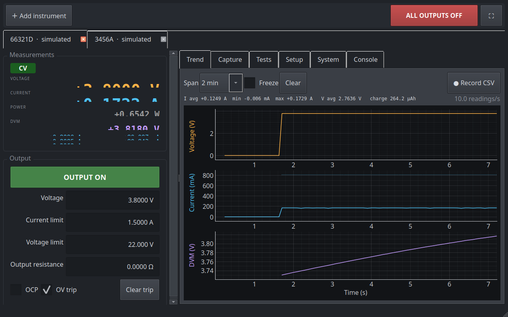
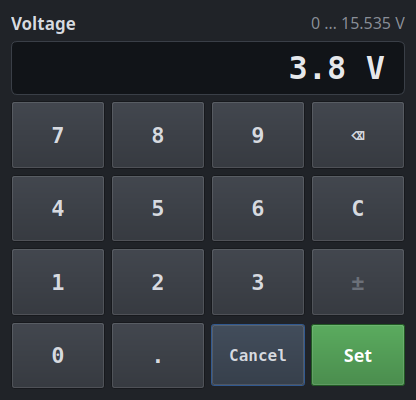
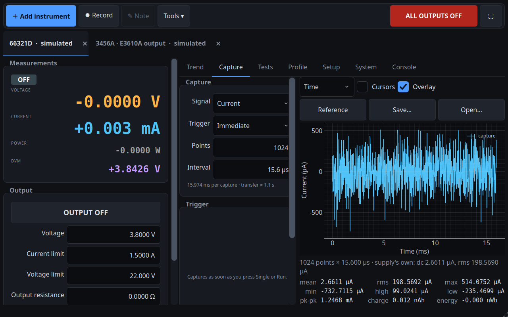
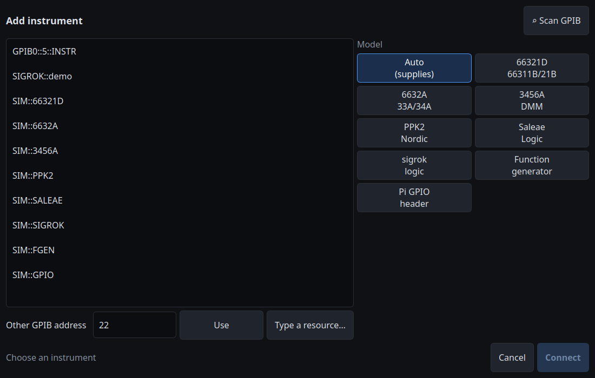
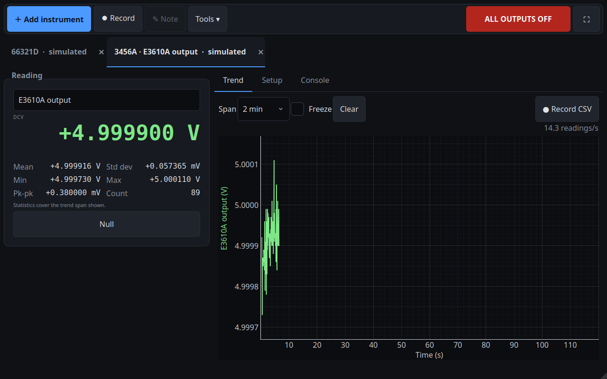

# Raspberry Pi & Touch Screen

Other chapters: [Hardware](01-hardware-and-resources.md) · [Installation](02-installation.md) · [User's Guide](03-users-guide.md) · [Technical Reference](04-technical-reference.md) · [How-to guides](06-howtos.md) · [README](../README.md)

EE Workbench runs on a Raspberry Pi with a touch screen as a dedicated bench controller. The layout is tuned for a **10-inch 1280×800** panel. A mouse and keyboard work alongside touch.

## What you need

| Item | Notes |
|---|---|
| Raspberry Pi 4 or 5 | 2 GB RAM is plenty. A Pi 3 works but plots refresh more slowly. |
| Raspberry Pi OS (64-bit, desktop), Bookworm or later | The *Lite* image has no desktop and won't run the GUI. |
| 10-inch 1280×800 touch screen | Other sizes work; see [Other screen sizes](#other-screen-sizes). |
| NI GPIB-USB-HS | Same adapter as on the PC; see *Hardware & Resources*. |
| Keyboard and mouse (optional) | Useful for the console and channel names. |

## One-step setup

Clone the project to `~/ee-workbench` and run the setup script:

```bash
git clone git@github.com:dcm271/ee-workbench.git ~/ee-workbench
cd ~/ee-workbench
./scripts/setup-pi.sh
sudo reboot
```

The SSH clone needs a GitHub key on the Pi. For read-only use, `https://github.com/dcm271/ee-workbench.git` works too.

The script is safe to re-run. It does the following:

1. Installs the system packages. PyQt6 and numpy come from apt, because building them with pip on a Pi takes hours. It also installs `qt6-wayland` for the Bookworm desktop, plus `sigrok-cli` and the fx2lafw firmware for USB logic analyzers. Saleae's Logic 2 doesn't run on ARM, so on the Pi a sigrok analyzer takes its place. It adds you to `dialout` (PPK2) and `plugdev` (logic analyzers).
2. Creates `.venv` and installs `requirements.txt` into it (pyqtgraph, pyvisa-py, gpib-ctypes, …).
3. Runs the test suite against the simulators.
4. Builds the GPIB driver with `scripts/install-gpib-driver.sh`. It uses the Pi's `linux-headers-$(uname -r)` package, and skips the kernel-module build if the running kernel already provides `ni_usb_gpib`.
5. Adds **EE Workbench** to the application menu and to `~/.config/autostart`, so it starts full screen at every login. The autostart entry also uses `--restart-on-crash`, so the screen never stays on an empty desktop (see [below](#start-again-after-a-crash)).

| Option | Effect |
|---|---|
| `--no-gpib` | Skip the driver build, e.g. to try the simulators first |
| `--no-autostart` | Menu entry only; don't launch at login |
| `--no-pdf` | Skip WeasyPrint (PDF reports); HTML reports still work |
| `--docs` | Also install the PDF tool-chain (Markdown + WeasyPrint) |

> **After a kernel upgrade** (`apt full-upgrade` can bring a new kernel), re-run `scripts/install-gpib-driver.sh`. The module is built for one specific kernel.

## The launcher file

The repository includes **`ee-workbench.desktop`**. Copy it to the place you want the launcher:

| Where | Copy to |
|---|---|
| Start at login | `~/.config/autostart/` |
| Application menu | `~/.local/share/applications/` |
| Desktop icon | `~/Desktop/` (the file manager may ask you to trust it the first time) |

It assumes the project is in `~/ee-workbench` and starts full screen. If you cloned somewhere else, edit its `Exec=` line. Remove `--fullscreen` to start in a window. `setup-pi.sh` installs the file with the correct path filled in (and, for autostart, `--restart-on-crash` added).

## Start again after a crash

EE Workbench catches its own errors and keeps running (see *When something goes wrong* in the User's Guide), but a crash inside Qt or a driver library can still end it. On a bench screen nobody is watching, `run.sh --restart-on-crash` starts it again 3 s later, reopening the same instruments:

```
Exec="/home/<you>/ee-workbench/run.sh" --restart-on-crash --fullscreen
```

- A normal quit (**✕**, logging out, shutting down) is not a crash, so it stays closed.
- Five crashes within two minutes stop the restarts, so a fault that happens at every start can't loop for ever.
- Each restart is noted in `~/.config/ee-workbench/crash.log`; the crash itself is in `fault.log` next to it.
- Outputs are never switched on by a restart: supplies keep whatever they were doing, and the app reads their state as usual. Use the [watchdog](03-users-guide.md#watchdog) if the DUT must be protected while nobody is there.

## Instruments at start-up

By default the app reopens whatever was open last time, and waits up to 30 s at boot for the GPIB adapter to come up. If you'd rather it always open a fixed set of instruments, or scan the bus, edit `~/.config/ee-workbench/config.toml`. *Instruments at start-up* in the User's Guide explains the file. If an instrument is off when the Pi boots, switch it on and tap **⟳ Retry** on its tab.

## Full screen

| Action | How |
|---|---|
| Start full screen | `./run.sh --fullscreen` (the launcher does this) |
| Leave / re-enter full screen | **⛶** in the top bar, or **F11** |
| Quit | **✕** at the top right (only shown in full screen), then confirm |
| Hide the mouse pointer | `./run.sh --fullscreen --hide-cursor` (for touch-only setups) |

Quitting does not change any supply's output. Use **ALL OUTPUTS OFF** first if you want the bench safe.

To stop the screen from blanking during long logging runs, open `sudo raspi-config`, go to **Display Options → Screen Blanking**, and choose **No**.

## Touch mode

The touch layout turns on automatically when the app finds a touch screen, or a display of 1280×800 or smaller. You can also set it yourself:

| Force it | How |
|---|---|
| Touch layout | `./run.sh --touch`, or `EEWB_TOUCH=1` |
| Desktop layout | `./run.sh --no-touch`, or `EEWB_TOUCH=0` |



What's different from the desktop layout:

- **Larger controls.** Buttons, boxes, check boxes and tabs are at least 52 px tall (about 9 mm).
- **The left column holds only readouts and output controls,** so the essentials never need scrolling. The supply's identity, *RST and measurement setup move to a **Setup** tab next to Trend, Capture, Tests, System and Console. The System tab becomes a single scrolling column. On the 3456A the reading and statistics stay on the left, and function, range and integration move to Setup.
- **Numeric keypad.** Tapping a voltage, current, OVP, sample count or poll-delay box opens a keypad. It shows the allowed range, and **Set** greys out for values outside it. Pressing **Set** also sends the value to the instrument, so there's no separate Set button. The physical keyboard works on the keypad too: digits, `.`, `-`, Backspace, Delete (clear), **Enter** (set) and **Esc** (cancel).

  

- **Two taps to turn an output ON.** The first tap arms the button (amber, "Tap again to turn ON"). A second tap within 3 seconds turns the output on. Turning an output **off** always takes one tap.
- **ALL OUTPUTS OFF** is a large red button in the top bar. **Esc** still does the same from the keyboard, except while a keypad is open, where Esc only cancels the keypad.
- **Capture, Tests and System** work the same as on the desktop. Their settings sit in a column that scrolls by dragging, and every number box opens the keypad. The Capture toolbar wraps onto two rows.

  

- **Plots don't pan or zoom** under a finger. The **Span** selector sets the time window, and Y always autoscales. Scroll areas scroll by dragging.
- **＋ Add instrument** replaces the connection toolbar. It scans the GPIB bus when it opens and lists what it finds plus the simulators. Pick one (or enter a GPIB address with the keypad, or **Type a resource…** for a LAN or USB instrument such as a function generator), choose the model, then tap **Connect**. For the 3456A, tap the **3456A DMM** model button, because the meter can't identify itself.

  



Typing is still available where it makes sense: channel names and the console use the keyboard as usual.

## The GPIO header

On the Pi, the 40-pin header is an instrument too: it appears in the resource list (and **＋ Add instrument**) as `GPIO::/dev/gpiochip0`. Open it and the [GPIO tab](03-users-guide.md#gpio-panel-raspberry-pi-header) lists every usable pin by GPIO number and physical pin. Set the pins you use to Output or Input, give them names (`relay`, `reset`, `done`), and the sequencer, the watchdog, scripts and the Remote API can use them by name. It's how a Pi bench controller power-cycles a DUT with a relay board, presses its buttons, and waits for it to finish booting.

`setup-pi.sh` installs `python3-libgpiod` and adds you to the `gpio` group; nothing else is needed. The pin map, electrical limits (**3.3 V only, never 5 V**) and wiring for relays, buttons and resets are in [Hardware → Raspberry Pi GPIO header](01-hardware-and-resources.md#raspberry-pi-gpio-header); a worked example is in [How-to guides](06-howtos.md#power-cycle-a-dut-with-a-relay-and-check-it-boots).

- Pins left **Off** aren't touched, so a pin used by a HAT, the touch screen or I²C stays theirs. A pin something else already holds can't be claimed; the tab says which.
- On a touch screen, **ON / off** in the State column switches an output with one tap (no confirmation: GPIO pins are low-power), and the **Pulse** button presses-and-releases.
- **Esc** sets every output to its inactive level; closing the tab releases the pins (they go back to inputs). Pin settings are remembered with the instrument.
- The Pi 5's header is on the RP1 chip (`pinctrl-rp1`); the app finds the right `/dev/gpiochip*` by its label, whatever its number.

## Remote API from your desk

With **Tools ▾ → Remote API** on (or `api = true` in `config.toml` for a Pi that starts the app at login), a notebook on your desktop can drive the Pi's bench through an SSH tunnel:

```bash
ssh -L 8765:127.0.0.1:8765 pi@bench-pi      # leave this open
scp pi@bench-pi:.config/ee-workbench/api.json ~/bench-pi-api.json
```

```python
import json
from ee_workbench.client import connect
d = json.load(open("/home/me/bench-pi-api.json"))
bench = connect("http://127.0.0.1:8765", d["token"])
```

See [Remote API](03-users-guide.md#remote-api-python-and-jupyter).

## Other screen sizes

The touch layout needs about 1180×460 pixels. Smaller screens (an 800×480 panel, for example) will clip the right-hand side, so use the desktop layout with a lower resolution, or a larger screen. Larger screens just give the plots more room.

## Troubleshooting on the Pi

| Problem | Fix |
|---|---|
| `linux-headers-…` not found | `sudo apt full-upgrade && sudo reboot`, then re-run the setup. The headers must match the running kernel. |
| Panel PC with its maker's own kernel (e.g. EDATec, `uname -r` without `+rpt`) | Nothing to do: when no headers package exists for the running kernel, `install-gpib-driver.sh` prepares a matching kernel tree itself (`scripts/prepare-kernel-tree.sh`). It downloads the kernel source (about 230 MB), configures it with `/boot/config-$(uname -r)`, and takes the symbol checksums from the modules already installed, so the driver loads on that exact kernel. It takes a few minutes and keeps the tree in `~/kbuild` (about 1.5 GB) for re-runs; delete it once the driver works if you need the space. Don't install the stock Raspberry Pi kernel on such a unit: the maker's kernel carries its display and touch drivers. |
| "the linux-gpib library is not installed" | The install script didn't finish. Run `./scripts/install-gpib-driver.sh` and read its messages: since the library is installed even when the kernel driver can't be built, the app starts either way, but the adapter only works once the driver builds. |
| Adapter found but "permission denied" on `/dev/gpib0` | Log out and back in (or reboot) after the install, so your account picks up the `gpib` group. |
| Taskbar or title bar still showing | The app was started without `--fullscreen` (e.g. `./run.sh` from a terminal). Tap **⛶** or press F11. The menu entry and autostart launcher start full screen. |
| Window opens but looks tiny or huge | Check **Screen Configuration** in the Pi menu is at 1280×800. Qt follows the desktop's scale setting. |
| `qt.qpa.plugin: Could not load the Qt platform plugin "wayland"` | `sudo apt install qt6-wayland`, or run with `QT_QPA_PLATFORM=xcb`. |
| Touches land in the wrong place | Use the Pi's **Screen Configuration → Touchscreen** to map the touch device to the right display. |
| `cannot execute binary file: Exec format error` | Something built on a PC (x86) was copied to the Pi. Re-run `./scripts/setup-pi.sh`: it detects and rebuilds a copied `.venv` and GPIB build. Cloning with git instead of copying the folder avoids this. |
| "gpib_ctypes … could not locate the gpib library", or "GPIB library is installed but can't be loaded" | The linux-gpib library is missing, or is an x86 copy from a PC. Run `rm -rf vendor && ./scripts/install-gpib-driver.sh`; its last step checks that the library loads. |
| GPIO tab: "No GPIO chip found" | `python3-libgpiod` missing or no `/dev/gpiochip*` (not a Pi?). `ls /dev/gpiochip*`; re-run `setup-pi.sh`. |
| GPIO: "Permission denied" | Log out and back in after setup, for the `gpio` group. |
| GPIO: a pin is "busy" | I²C, SPI, the serial console, 1-Wire or a HAT's overlay uses it (`gpioinfo` shows the owner). Pick another pin or turn that interface off in `raspi-config`. |
| App doesn't start at login | Run `~/ee-workbench/run.sh --fullscreen` from a terminal to see the error. Check `~/.config/autostart/ee-workbench.desktop` points at the right folder. |
| App keeps restarting, or stopped after several restarts | It crashes at start-up. Look at the end of `~/.config/ee-workbench/crash.log` and `fault.log`. Starting with `./run.sh --open none` (no instruments) shows whether one instrument is the cause. |
| A tab shows ⚠ and **⟳ Reconnect** | The instrument stopped answering (switched off, cable pulled). Fix that and tap **⟳ Reconnect**. |
