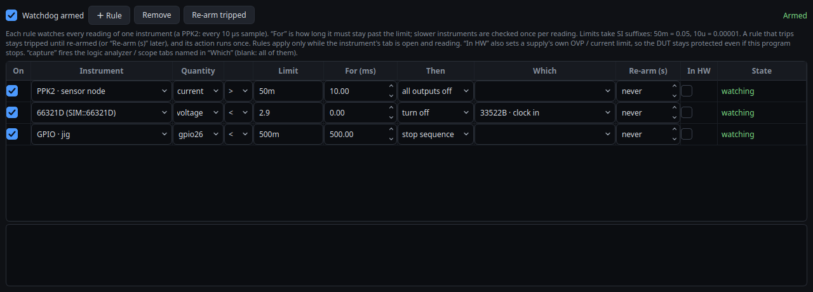

# How-to Guides

Other chapters: [Hardware](01-hardware-and-resources.md) · [Installation](02-installation.md) · [User's Guide](03-users-guide.md) · [Technical Reference](04-technical-reference.md) · [Raspberry Pi](05-raspberry-pi.md) · [README](../README.md)

Each recipe is a complete job from start to finish. The [User's Guide](03-users-guide.md) explains every control the recipes use.

| Recipe | Uses |
|---|---|
| [Try everything without hardware](#try-everything-without-hardware) | simulators |
| [Measure sleep current and estimate battery life](#measure-sleep-current-and-estimate-battery-life) | PPK2, events |
| [Find out what each current burst is](#find-out-what-each-current-burst-is) | PPK2, logic analyzer, alignment, events |
| [Power-cycle a DUT with a relay and check it boots](#power-cycle-a-dut-with-a-relay-and-check-it-boots) | GPIO, sequencer, Wait for |
| [Run a pass/fail test and get a report](#run-a-passfail-test-and-get-a-report) | sequencer limits, reports, setups |
| [Sweep the supply voltage and plot current](#sweep-the-supply-voltage-and-plot-current) | sequencer sweep |
| [Find a DUT's brown-out voltage](#find-a-duts-brown-out-voltage) | supply profile, session |
| [Measure a frequency response](#measure-a-frequency-response) | function generator, DMM, sequencer |
| [Measure a regulator's efficiency](#measure-a-regulators-efficiency) | two supplies, math channels |
| [Protect a DUT with the watchdog](#protect-a-dut-with-the-watchdog) | watchdog |
| [Switch between bench setups](#switch-between-bench-setups) | setups |
| [Drive the bench from Jupyter](#drive-the-bench-from-jupyter) | Remote API |
| [Run hardware tests from pytest or CI](#run-hardware-tests-from-pytest-or-ci) | Remote API |
| [Analyse a recorded session](#analyse-a-recorded-session) | session viewer, cursors, export |
| [Connect a LAN function generator](#connect-a-lan-function-generator) | function generator |
| [Recover from a pulled cable or a crash](#recover-from-a-pulled-cable-or-a-crash) | ⟳ Reconnect, crash log, restart-on-crash |
| [Add your own SCPI instrument](#add-your-own-scpi-instrument) | instrument definition file, console, check_instruments |
| [Drain a battery with an electronic load](#drain-a-battery-with-an-electronic-load) | SCPI load, watchdog, session |
| [Catch a glitch with the scope](#catch-a-glitch-with-the-scope) | scope, watchdog capture, flight recorder |
| [Measure two rails with two PPK2s](#measure-two-rails-with-two-ppk2s) | several PPK2s, alignment, math |
| [Set up a production test station](#set-up-a-production-test-station) | production test, sequencer limits, barcode scanner |
| [Leave a test running overnight](#leave-a-test-running-overnight) | safety, In HW limits, flight recorder, resume |

---

## Try everything without hardware

Every instrument has a simulator, so you can learn the app (or develop a sequence) at your desk.

```bash
./run.sh SIM::66321D SIM::PPK2 SIM::SIGROK SIM::FGEN SIM::GPIO
./run.sh SIM::DP832 SIM::34461A SIM::DL3021 SIM::SCOPE SIM::PPK2 SIM::PPK2#2   # the newer instruments
```

1. **66321D tab:** set 3.3 V, **Set**, then **Output ON**. The simulated phone load draws bursts; watch the **Trend**.
2. **PPK2 tab:** **DUT POWER** on. Turn on **Log scale** to see sleep µA and radio mA together. In **Events**, press **Find events**.
3. **Logic tab (sigrok):** set **Align with PPK2** to D7 ↔ PPK2 D7, tick D0 and D7, add a **UART** decoder on D0 at 115200, and **▶ Capture**. The PPK2 current appears under the lanes.
4. **GPIO tab:** set GPIO20 to Output and GPIO21 to Input. Switching 20 also switches 21, because the simulated jig wires them together. GPIO26 is a button that is pressed every 2 s.
5. **DP832, 34461A, DL3021 tabs** (second command): switch an output or the load's input on and watch the readings; change the meter's **Function**. **SCOPE tab:** **Single → capture**.
6. **Tools ▾ → Sequencer**, **Watchdog**, **Math channels**, **Production test**: see the recipes below.

---

## Measure sleep current and estimate battery life

**You need:** a PPK2, and the DUT's battery removed.

1. Wire the PPK2 as a **source meter**: VOUT to the DUT's battery +, GND to battery −. Plug it in and open it (`PPK2::…`).
2. **Source meter**, **Voltage** = the battery's nominal voltage (e.g. 3000 mV for a CR2032), **DUT POWER** on.
3. Let the device settle into its normal cycle (advertising, sensing, sleeping).
4. **Trend** tab: **Span** 2 min, **Log scale** on. The readouts give the **Average** over the span.
5. **Events** tab: **Data** = *Trend span shown*, **Above** = a level clearly over the sleep current (e.g. 0.5 mA), and **Find events**. The summary gives:
   - the number of events and their **rate** (e.g. 1.0/s),
   - the **charge per event** (e.g. 18 µC),
   - the average current **between** events, which is the true sleep current.
6. Battery life ≈ capacity ÷ average current. For example, 220 mAh ÷ 21 µA ≈ 10,500 h ≈ 14 months. Then see which term dominates: sleep current × time, or events × charge. The **Histogram of Charge** shows whether some events cost much more than others.

To keep a record, press **⏺ Record** before step 4. The session holds the trend, and the viewer's [cursors](03-users-guide.md#looking-through-a-session) can measure the charge over any stretch later.

---

## Find out what each current burst is

**You need:** a PPK2 and a logic analyzer (a Saleae, or any sigrok one; a few-dollar fx2lafw clone is enough).

1. Power the DUT from the PPK2 as above.
2. Connect the logic analyzer to the buses you care about (UART TX, I²C SDA/SCL, SPI) **and** connect one irregular signal to both the analyzer and a PPK2 logic input. UART TX or a firmware debug pin works well. Wire the PPK2's logic-header GND to the DUT, and its VCC to the DUT's I/O voltage.
3. **Logic tab:** add the bus decoders. In **Align with PPK2**, choose the PPK2 tab and the shared signal (e.g. analyzer D0 ↔ PPK2 D0). Set **Duration** to cover several events (e.g. 2 s).
4. **▶ Capture.** The note should say "✓ … edges match, ±5 µs".
5. **PPK2 → Events → Live buffer → Find events.** The **Bus during the event** column lists the decoded traffic inside each burst, e.g. `i2c write 0x48 …`, `uart "TX OK"`. Sort by **Charge** to see the most expensive transactions first.
6. Select an event to see its waveform. On the logic tab, click a decoded row to jump to it, with the current drawn underneath.

---

## Power-cycle a DUT with a relay and check it boots

**You need:** a Raspberry Pi running OtterBench, a 1-channel 5 V relay module, and a DUT with a pin that goes high when it has booted (or a UART message; see the variant at the end).

**Wiring** (see [Hardware → GPIO](01-hardware-and-resources.md#raspberry-pi-gpio-header)):

| From | To |
|---|---|
| Pi pin 2 (5 V) | relay module VCC |
| Pi pin 6 (GND) | relay module GND |
| Pi pin 38 (GPIO20) | relay module IN |
| Supply + | relay COM; relay NO → DUT + |
| Supply − | DUT − |
| DUT "booted" pin (3.3 V logic) | 1 kΩ → Pi pin 40 (GPIO21) |
| DUT GND | Pi GND (pin 39) |

**In the app:**

1. Open the supply and `GPIO::…`. In the GPIO tab, set GPIO20 to **Output**, named `relay`, with **Active low** ticked (most relay modules switch on when IN is low). Set GPIO21 to **Input**, named `booted`, **Pull** down.
2. Check by hand: **ON** in the relay row should click the relay, and the DUT should start. **Esc** turns it off.
3. **Tools ▾ → Sequencer**, with these steps:

| Action | Instrument | Setting | Value | Min | Max | Results column |
|---|---|---|---|---|---|---|
| Set | 66321D | voltage | 3.3 | | | |
| Set | 66321D | output | on | | | |
| Set | GPIO | relay | on | | | |
| Wait for | GPIO | booted | 1 timeout=5 | | 1.5 | boot_s |
| Measure | 66321D | current | 1 | | 0.02 | I_run |
| Set | GPIO | relay | off | | | |
| Wait | | | 2 | | | |

4. Choose **Repeat** with 200 passes. Leave **Stop on first fail** off for a soak test, so every failure is counted, or turn it on to stop at the first failure and look. Tick **Outputs off at the end**.
5. **▶ Run.** Each row gives the boot time and the running current, marked PASS or FAIL. Plot `boot_s` against `pass` to see drift. When the run finishes, use **Report…**.

**Variant: boot detected on the UART.** Replace *Wait for* with *Capture Logic* (with the analyzer set to **Trigger** on TX's falling edge, and a UART decoder) and **Min** `1`. The pass then fails if nothing was printed.

---

## Run a pass/fail test and get a report

1. Open every instrument the test needs, and give the tabs short names (e.g. "DUT rail", "3V3 out").
2. In the sequencer, build the steps: power up, wait, then **Measure** each quantity with its **Min** / **Max**. Limits accept expressions, e.g. `3.3 * 0.98` and `3.3 * 1.02`.
3. **Repeat** 1, tick **Stop on first fail** and **Outputs off at the end**.
4. **▶ Run.** The status line shows **PASS** or **FAIL**, failing cells are red, and the `failures` column says what was wrong and what was wanted.
5. **Report…** → `board-0042.pdf`. The report holds the verdict, the instruments with their IDs, the results and plots, the steps, and the log.
6. **Tools ▾ → Setups… → Save current as…** "Board test". Next time it's **Recall**, then **Run**.

To test many boards and keep one file, use **Repeat** with the number of boards, and add a **Note** step `Board {i}: swap the DUT` followed by a **Wait for** on a GPIO "next" button. **Save CSV…** at the end gives one row per board.

---

## Sweep the supply voltage and plot current

1. Sequencer → **Sweep x**, from `1.8` to `3.6`, step `0.1`.
2. Steps: *Set PPK2 voltage* `x` (or a supply's voltage) → *Wait* `0.5` → *Measure PPK2 current* `2`, column `I_avg` → *Note* `{x} V done`.
3. **▶ Run**, then plot `I_avg` against `x`. **Save CSV…** or **Report…**.

For a log sweep (e.g. load current from 1 µA to 100 mA), sweep `x` from `-6` to `-1` and set `10 ** x`.

---

## Find a DUT's brown-out voltage

1. Open the supply powering the DUT, and something that shows the DUT is alive: a GPIO input on a heartbeat pin, or the logic analyzer, or just the supply's current.
2. Start a session (**⏺ Record**) so that everything lands on one time axis.
3. Supply tab → **Profile**: **Vary** = voltage, profile `ramp 3.3..1.5 for=90 rate=10`. Turn the output on, then press **▶ Run profile**.
4. Stop the session and open it. In the viewer, tick the supply's voltage and the alive signal (GPIO pin or current), turn on **Cursors**, and put A where the alive signal stops. **at A** for the voltage is the brown-out level.
5. For the power-on threshold, run `ramp 1.5..3.3 for=90`. Use `steps 2.4..1.8 n=13 dwell=5` if the DUT needs time at each level to show the problem.

---

## Measure a frequency response

With a generator and a scope, **Tools ▾ → Bode plot…** does this with phase as well ([guide](03-users-guide.md#bode-plot)). With a meter:

**You need:** a function generator and the 3456A (or any DMM) in ACV.

1. Generator CH1 → the circuit's input. Set **Sine**, the amplitude you want (mind the 50 Ω / High-Z setting, see [Hardware](01-hardware-and-resources.md#function-generators)), offset 0, and **CH1 output** on.
2. DMM across the output, function **ACV**, integration 10 PLC.
3. Sequencer → **Sweep x** from `1` to `5` step `0.1` (that's 10 Hz to 100 kHz, 41 points).
4. Steps: *Set FGEN frequency* `10 ** x` → *Wait* `1.5` → *Measure 3456A value* `0`, column `Vout`.
5. Plot `Vout` against `x`. Add a math step in a script if you want dB:

```python
for x in np.arange(1, 5.01, 0.1):
    f = 10 ** x
    bench.set("FGEN", "frequency", f)
    bench.wait(1.5)
    v = bench.measure("3456A", "value")
    bench.record(f_Hz=round(f, 1), Vout=v, gain_dB=20 * math.log10(v / 0.3536))   # 1 Vpp in = 0.3536 Vrms
```

Alternatively, without the sequencer: generator **Profile** tab, **Vary** = frequency, `logsteps 10..100000 n=41 dwell=1.5`, and record the DMM.

---

## Measure a regulator's efficiency

With a supply and a load, **Tools ▾ → Regulator test…** does the whole sweep ([guide](03-users-guide.md#regulator-test)). By hand:

1. 6632A → regulator input (tab named "in"). The 66321D, or a resistor with the 66321D measuring it, on the output (tab named "out").
2. **Tools ▾ → Math channels → ＋ Channel**: name `eff`, expression `_66321d_out.power / _6632a_in.power * 100`, unit `%`. (The **Signals** list shows the exact names; double-click one to insert it.)
3. Add `P_loss` = `_6632a_in.power - _66321d_out.power`, unit `W`.
4. Vary the load and read `eff` live. For a curve, use the sequencer to sweep the load current and **Measure** the two powers, then compute the efficiency in a script with `bench.record(...)`.

---

## Protect a DUT with the watchdog



**Tools ▾ → Watchdog → ＋ Rule** for each case:

| Protect against | Rule |
|---|---|
| A shorted or latched-up DUT | PPK2 · current **>** `80m` for `5` ms → **all outputs off** |
| Overheating a regulator under test | 66321D · power **>** `2.5` for `1000` ms → **turn off** 66321D |
| Back-powering a DUT through its inputs | DUT rail · voltage **<** `2.9` → **turn off** FGEN (and the GPIO tab) |
| An operator pressing an e-stop | GPIO · `gpio26` (button to GND, Pull up) **<** `0.5` → **all outputs off** |
| A sequence running on after a failure | 3V3 out · value **<** `3.0` for `200` ms → **stop sequence** |

Keep **Watchdog armed** ticked. A trip shows a message, writes a note into the session, and marks the rule **TRIPPED** until you press **Re-arm tripped**.

**Put the limit in the supply too.** For a *voltage >* or *current >* rule on a supply, tick **In HW**: the supply's own OVP / current limit is set to the rule's limit, so it protects the DUT within microseconds even if the computer stops. The State column shows *+ HW* when it's set. The watchdog then adds what the supply can't do on its own: rules that span instruments, hold times, and actions on other instruments.

---

## Switch between bench setups

1. Arrange the bench for one job: instruments, tab names, decoders, GPIO pins, the sequence, watchdog rules and math channels.
2. **Tools ▾ → Setups… → Save current as…** "nRF52 sleep current", with a description.
3. Arrange it for another job and save that as "Regulator efficiency".
4. To switch, select a setup and press **Recall**: the tabs close and the saved ones open. Outputs stay off and setpoints are read from the instruments.
5. **Export…** writes a setup to a JSON file you can email or commit to a project repo. **Import…** on another bench loads it. Resource names (GPIB addresses, serial numbers) must match that bench's, so edit them in the file if they don't.

---

## Drive the bench from Jupyter

1. In the app, open the instruments and switch on **Tools ▾ → Remote API**.
2. In a notebook (any Python 3.9+; pandas and matplotlib for the plotting below):

```python
import sys; sys.path.insert(0, "/home/me/otterbench")
from otterbench.client import connect
import numpy as np, pandas as pd

bench = connect()
bench.instruments()

rows = []
for v in np.arange(1.8, 3.61, 0.2):
    bench.set("PPK2", "voltage", float(v))
    bench.wait(0.5)
    rows.append({"V": v, "I_uA": bench.measure("PPK2", "current", 2.0) * 1e6})
df = pd.DataFrame(rows)
df.plot(x="V", y="I_uA", marker="o")
```

3. You can watch it happen in the app. **Esc** stops the running call, which raises `BenchError: stopped`.

Pass plain Python numbers (`float(v)`, not numpy scalars) as arguments, because they travel as JSON.

---

## Run hardware tests from pytest or CI

On a bench computer (a Pi is fine) running the app with `api = true` in `config.toml`, so the API is up after a reboot:

```python
# tests_hw/test_board.py
import pytest
from otterbench.client import connect, BenchError

@pytest.fixture(scope="module")
def bench():
    try:
        b = connect()
        b.instruments()
    except BenchError as e:
        pytest.skip(f"no bench: {e}")
    b.set("DUT rail", "voltage", 3.3)
    b.set("DUT rail", "output", "on")
    b.wait(0.5)
    yield b
    b.outputs_off()

def test_boots(bench):
    bench.gpio("GPIO", "reset", "pulse 0.05")
    assert bench.wait_for("GPIO", "booted", 1, timeout=5) < 1.5

def test_sleep_current(bench):
    i = bench.measure("PPK2", "current", 5.0)
    assert bench.expect("I_sleep", i, hi=10e-6), f"sleep current {i * 1e6:.1f} µA"

def test_says_hello(bench):
    cap = bench.capture("Logic")
    assert any("hello" in str(r).lower() for r in cap["rows"])
```

Run it as `pytest tests_hw -v`. As a CI step on a self-hosted runner on the bench machine, add `--junitxml=hw.xml` for the CI's test report. Each `expect()` and `record()` also shows in the app's sequencer results, and in the session if one is recording, so a failed CI run can be looked at in the session viewer.

---

## Analyse a recorded session

1. **Tools ▾ → Open session…** and pick the `.otter` file.
2. Tick the signals to plot. Scroll to zoom, or click a capture, note or decoded row to jump to it.
3. Turn on **Cursors** and drag **A** and **B** around the stretch you care about. The table gives the value at each cursor, the difference, the mean, the min/max, and the charge or energy between them.
4. **Math…** derives a new trace, e.g. power = `_66321d.voltage * ppk2.current`, or energy with **Integrate**.
5. Zoom to the stretch to keep, then use **Export CSV…** (the ticked signals), **Save PNG…**, or **Report…** (HTML/PDF with plots, notes and results).

Other tools can read the file too. It's SQLite: `sqlite3 run.otter "select * from notes"`, or in Python `pandas.read_sql("select * from s_1", sqlite3.connect("run.otter"))`. The tables are listed in the [Technical Reference](04-technical-reference.md#session-files-sessionpy).

---

## Connect a LAN function generator

1. On the generator: **Utility → I/O → LAN**. Set a static IP (e.g. 192.168.1.50/24), or reserve one in your router, and make sure LAN/VXI-11 is enabled.
2. From the computer, `ping 192.168.1.50` should answer.
3. In the app, type `TCPIP::192.168.1.50::INSTR` into the **Resource** box, set **Model** to *Auto-detect* (or *Function generator*), and **Connect**. On a touch screen, use **＋ Add instrument → Type a resource…**.
4. The tab shows the generator's current settings and outputs, read from it. Nothing is changed by connecting.
5. To have it open at every start, connect it once (`open = "last"` remembers it), or add it to `config.toml`:

```toml
[[instrument]]
resource = "TCPIP::192.168.1.50::INSTR"
model = "FGEN"
```

If VXI-11 doesn't answer, use the raw socket form: `TCPIP::192.168.1.50::5025::SOCKET` for Keysight and Siglent, or `::5555::SOCKET` for Rigol.

## Recover from a pulled cable or a crash

**An instrument stopped answering** (its tab shows ⚠ and **⟳ Reconnect**):

1. Fix the cause: switch it back on, replug the USB cable, reseat the GPIB connector.
2. Tap **⟳ Reconnect** on the tab. It closes and reopens in the same place, with its tab settings kept, and reads the instrument's state as usual (nothing is switched on).
3. If you were recording a [session](03-users-guide.md#sessions-everything-in-one-file), it carries on; the gap shows as a gap.

With **Reconnect automatically** ticked in **Tools ▾ → Safety…**, step 2 happens by itself, as soon as the instrument answers again (a USB device: as soon as it is plugged back in).

**A window "OtterBench: internal error" appeared:** the app caught a problem and carried on. Close the window and keep working. To report it, send `~/.config/otterbench/crash.log`.

**The app closed by itself:**

1. Check the bench first: outputs stay as they were when the app ended.
2. Start it again (`./run.sh`). It reopens the same instruments; supply setpoints are read from the supplies.
3. The cause is in `~/.config/otterbench/fault.log` (a crash in Qt or a driver) or `crash.log`.
4. On a screen nobody watches, launch it with `./run.sh --restart-on-crash --fullscreen` so it comes back by itself (the Pi's autostart already does), and see [Leave a test running overnight](#leave-a-test-running-overnight) for switching outputs off and resuming automatically.

**Esc reported "⚠ FAILED for …":** every other output was switched off; switch the named instrument off at its front panel, then reconnect it.

---

## Add your own SCPI instrument

Any instrument that takes SCPI-style commands (a meter, load, supply, switch unit, temperature controller…) can get its own tab from a small text file, with no programming. As an example, take a single-output electronic load whose programming manual lists:

| What | Command | Query | Answer |
|---|---|---|---|
| Mode | `FUNC CURR` / `FUNC VOLT` / `FUNC RES` | `FUNC?` | `CURR` / `VOLT` / `RES` |
| CC level | `CURR 1.5` | `CURR?` | `1.500` |
| Input | `INP ON` / `INP OFF` | `INP?` | `1` / `0` |
| Readings | | `MEAS:VOLT?`, `MEAS:CURR?` | `12.034` |
| Errors | | `SYST:ERR?` | `0,"No error"` |

1. **Check the commands on the instrument.** Open it with any SCPI model (say **Model → Any SCPI meter (READ? only)**), go to its **Console** tab, and try each query: `*IDN?`, `FUNC?`, `MEAS:VOLT?`. Note the exact answers; the console shows them verbatim. Also note a part of the `*IDN?` answer that names the model (`EL-150`).
2. **Start from the closest built-in.** Copy one from `otterbench/instruments/scpi_defs/` (here `DL3021.toml`, a load) to `~/.config/otterbench/instruments/el150.toml`:

   ```bash
   mkdir -p ~/.config/otterbench/instruments
   cp otterbench/instruments/scpi_defs/DL3021.toml ~/.config/otterbench/instruments/el150.toml
   ```

3. **Edit it** to match the manual:

   ```toml
   id = "EL150"
   name = "Acme EL-150 electronic load"
   type = "load"
   idn = ["EL-150"]
   init = ["*CLS"]
   error_query = "SYST:ERR?"
   off = ["INP OFF"]
   notes = "Set the level for the mode before switching the input on."

   [[reading]]
   name = "voltage"
   label = "Voltage"
   query = "MEAS:VOLT?"
   unit = "V"
   sim = "12.0 - 0.05 * cc * input"

   [[reading]]
   name = "current"
   label = "Current"
   query = "MEAS:CURR?"
   unit = "A"
   sim = "cc * input if function == 'CC' else 0"

   [[setting]]
   name = "function"
   label = "Mode"
   kind = "choice"
   query = "FUNC?"
   options = [
     { label = "CC", set = "FUNC CURR", reply = "^CURR" },
     { label = "CV", set = "FUNC VOLT", reply = "^VOLT" },
     { label = "CR", set = "FUNC RES",  reply = "^RES" },
   ]

   [[setting]]
   name = "cc"
   label = "CC current"
   kind = "number"
   unit = "A"
   min = 0
   max = 30
   set = "CURR {value}"
   query = "CURR?"

   [[setting]]
   name = "input"
   label = "Input"
   kind = "bool"
   set = "INP {on_off}"
   query = "INP?"
   output = true
   ```

   The [definition reference](04-technical-reference.md#instrument-definition-files-toml) explains every key. Points to watch: names are identifiers (`cc`, not `CC current`), a reading and a setting can't share a name, and a `reply` pattern must match only its own option (anchor it with `^`).

4. **Check it:**

   ```bash
   .venv/bin/python -m otterbench.check_instruments ~/.config/otterbench/instruments/el150.toml
   ```

   `ok` means the file is valid and works with its own simulator. Errors name the key and say what's wrong.

5. **Try it on the simulator:** `./run.sh SIM::EL150`. Set the mode, the level, switch the input on, and see the readings follow your `sim` expressions.
6. **Open the real instrument** with *Auto-detect* (your `idn` entry picks the file) or by choosing **Acme EL-150 electronic load** under Model. Watch the **Console** while you change each setting: every command should be followed by no error. If a reading shows **—** or the log shows an error such as `-113 Undefined header`, the command differs on your model: find the right one in the console and fix the file. Restart the app to reload it.
7. **Share it**: once it works, set `tested = "EL-150 fw 1.02"` and consider contributing the file to the project, so others get it built in.

A **multi-output** instrument uses `channels = 2` and `{ch}` in its commands (`set = "VOLT {value},(@{ch})"`); see `DP832.toml`. A **meter** whose unit follows its function uses `unit_from = "function"` on its reading and a `unit` on each option; see `34461A.toml`.

---

## Drain a battery with an electronic load

For capacity and resistance over whole cycles, use **Tools ▾ → Battery tester…** ([guide](03-users-guide.md#battery-tester)). With the sequencer:

Measure a battery's capacity at constant current, stopping at its cut-off voltage.

1. Connect the battery to the load's input (short, thick leads; the load's sense leads to the battery terminals if it has them). Open the load: `SIM::DL3021` to practise.
2. On the load's tab: **Mode** CC, **CC current** `0.5` A (C/5 for a 2.5 Ah cell).
3. **Tools ▾ → Watchdog**: *DL3021 · voltage < `3.0` for `2000` ms → **turn off** DL3021*. The hold time stops a brief dip under load from ending the test early.
4. **⏺ Record** a session (everything), then switch **Input** on.
5. When it trips, open the session: put cursor **A** at the start and **B** at the trip, and the table gives the **charge** in C (÷ 3600 = Ah) and, with a [math channel](03-users-guide.md#math-channels) `dl3021.voltage * dl3021.current` integrated, the energy in Wh.

For a constant-power discharge (closer to a real DUT), use **Mode** CP instead.

---

## Catch a glitch with the scope

A rail occasionally dips, and you want to see the waveform when it does.

1. Open the scope and the supply or PPK2 that powers the DUT. On the scope, set the channel on the rail, a timebase that shows the event (e.g. 100 µs/div), and a trigger on that channel *falling* below the dip level, **sweep normal**.
2. **Tools ▾ → Watchdog**: *PPK2 · current > `30m` for `0.1` ms → **capture**, **Which** = the scope, **Re-arm (s)** `10`*. Each spike makes the scope capture; the rule re-arms itself 10 s later for the next one.
3. **⏺ Record** with **Only around events**, keep `5` s before and after. Leave it running.
4. Afterwards, open the session: every capture is a lane at its moment, with the PPK2's current around it, and nothing else filled the file.

The scope can also be triggered directly by its own trigger: **Single → capture** arms it and waits.

---

## Measure two rails with two PPK2s

Measure a DUT's MCU and radio supplies at the same time, on one time axis.

1. Power each rail through its own PPK2 (ampere-meter mode if the DUT has its own regulator; source mode to power each rail directly). Join the grounds.
2. Wire one DUT GPIO that toggles at irregular times (a debug pin set on each wake-up) to **D7** of both PPK2s, and each PPK2's logic VCC to the DUT's I/O voltage.
3. Open both: they appear as two `PPK2::/dev/serial/by-id/…` entries. Name the tabs `MCU` and `radio`. **▶ Run** on both.
4. On the **radio** tab, under **Time-align to another PPK2**: **Reference** `PPK2 · MCU`, **Shared input** `D7`, **Align now**, and tick **Keep aligned**.
5. **Tools ▾ → Math channels**: `ppk2_mcu.current + ppk2_radio.current` (total current), or each times its rail voltage for power.
6. Record a session: both currents, the sum and their logic inputs share one time axis in the viewer, so you can see which rail draws what during each event.

With the simulators: `./run.sh SIM::PPK2 SIM::PPK2#2` (their D7 carries the same debug pin).

---

## Set up a production test station

Test a batch of boards with a barcode scanner, a PASS / FAIL banner and a record of every unit.

1. **Build the test** in the sequencer, as in [Run a pass/fail test](#run-a-passfail-test-and-get-a-report): power on, wait, **Measure** each quantity with limits, **Outputs off at the end** ticked. Add a **Note** step `Testing {serial}` at the start if you record sessions. Run it once on a known-good board.
2. **Save it as a setup** ("Sensor board test"), so the station can be put back in one click.
3. **Tools ▾ → Production test…**: **Product** `Sensor board rev C`, **Operator** your initials, **Serial format** `SB\d{6}` (if your serials are SB + six digits), tick **Save an HTML report for every unit** and choose the folder.
4. Plug in a USB barcode scanner. Most need no setup; make sure it sends **Enter** after the code (the default on most; the scanner's manual has a "suffix: CR" barcode to scan if not).
5. For each board: put it in the fixture, scan its label. The banner shows **TESTING**, then **PASS** (green) or **FAIL** (red, with the failing value). Put it on the matching pile and scan the next.
6. **Yield** shows how the batch is doing; **Export CSV…** gives every result for a spreadsheet; each report holds the measurements of one unit.

A failed board that is reworked is simply scanned again: the history keeps both results, *first-pass yield* counts the failure, *final yield* the pass.

To stop a test (a board badly seated), press **■ Stop** or **Esc**: every output goes off and the unit is recorded as **ERROR**, not FAIL. On a Pi touch screen the window fills the screen; see [Raspberry Pi](05-raspberry-pi.md#production-test-station).

---

## Leave a test running overnight

An unattended sweep or soak test should survive a crash, a power blip, or a knocked cable, and never leave a DUT in danger.

1. **Limits in the supplies.** **Tools ▾ → Watchdog**: rules *supply · voltage > max* and *supply · current > max* with **In HW** ticked (State shows *+ HW*). The supplies now enforce them by themselves.
2. **Tools ▾ → Safety…**: tick
   - *Switch all outputs off when OtterBench quits*,
   - *After a crash, switch off the outputs of every instrument that was open*,
   - *Reconnect automatically*,
   - *After a crash, resume a running sequence* (if the sequence should carry on rather than stop safely),
   - and set a **heartbeat pin** if you have an external watchdog circuit ([wiring](05-raspberry-pi.md#unattended-bench)).
3. **Record only what matters**: **⏺ Record → Only around events**, keep 30 s before and 10 s after. Add watchdog rules with **mark session** for the things you want to catch (*current > 20m → mark session*, re-arm after 60 s).
4. **Start the app so it restarts itself**: `./run.sh --restart-on-crash` (the Pi's autostart already does this).
5. Start the sequence and leave.

In the morning: the session holds a window around every event; `crash.log` says whether anything restarted; if the app did crash, the outputs were switched off at the restart and, with resume on, the sequence carried on at the pass after the last one that finished.

